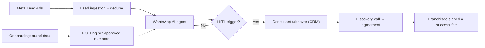

# Franchise-in-a-Box OS: Scale100x.ai take-home

Take-home assignment for the **AI Product Manager / AI Product Builder** role at Scale100x.ai.
This repo is the working space for the submission: planning, requirement breakdowns, architecture and (later) the code for the three prototypes.

> **Status:** Planning complete through Phase 2 (Task 1 drafted). All three Task 2 prototypes are planned (D-10); build and model not started.
> **Time:** ~15 h of focused work estimated. **Quality comes first, and estimates are for planning only, not cut-off points (D-07).** Steps run in the order below; submit as soon as R8 passes, inside the 72 h deadline.

---

## 1. Project brief

Scale100x.ai helps Indian retail and franchise brands (QSR, gyms, fashion, EV, two-wheeler servicing) open 100+ offline outlets a year. Its core product, **Franchise-in-a-Box OS**, is a dark-themed SaaS command center (React + Tailwind + Supabase) with five modules:

1. Brand Onboarding Portal
2. AI Franchise Model & ROI Engine
3. Design AI Agent (Collateral Studio)
4. AI Sales & Marketing Agent (Meta Ads, WhatsApp, Voice, Email, with HITL takeover)
5. HITL Sales CRM & Intelligence

A persistent **"AI: 76% | Human: 24%"** metric is shown across the platform.

The assignment asks for seven tasks, delivered as five links:

| Artefact | Contains | Format |
|---|---|---|
| Written submission | Tasks 1, 3, 4, 6, 7 + the Task 2 write-up for each prototype | Google Doc (anyone-with-link view) + PDF backup |
| Live prototype A | Task 2 Option A: Onboarding Wizard | Lovable build, public URL |
| Live prototype B | Task 2 Option B: WhatsApp AI Agent Panel | Lovable build, public URL |
| Live prototype C | Task 2 Option C: ROI Dashboard | Lovable build, public URL |
| Financial model | Task 5 (FreshBrew QSR) | Google Sheets |

The original brief file says "Choose ONE" for Task 2; the version we're working from asks for all three. We build all three as separate working apps (D-10).

The next round is a 60-minute live working session, so every decision here must be defensible and extendable live.

## 2. What we are creating

- **A decision-led written submission** a founder can skim in 10 minutes: an executive summary up front, then each task opening with a 2–3 line TL;DR.
- **Three working prototypes on one shared design shell:**
  - **A. Onboarding Wizard:** a 4-step flow with validated brand details, real file checks, a revenue-split donut and an explainable AI Readiness Score computed from the inputs.
  - **B. WhatsApp AI Agent Panel:** deterministic HITL triggers fire on real interactions, a real takeover state machine runs, and the AI/Human split is computed rather than hardcoded.
  - **C. ROI Dashboard:** a Franchise Model Card, 3-year projections, sourced India + US benchmarks and rule-based insights, using the same formulas as the R5 model.
- **A founder-friendly FreshBrew model** with all inputs on one Assumptions tab, franchisee economics kept separate from Scale100x revenue, payback, and ₹6L/₹8L/₹10L monthly-revenue sensitivity.
- **One connected system, not seven answers.** The 1c spec (takeover), Task 3 triggers and prompt, Task 4 ranking, prototype B and the 6A checkpoints all describe the same lead-to-close slice. Prototype A creates the brand record, C turns it into approved numbers, and B's agent quotes only those numbers.

## 3. Value proposition

**For the Scale100x founder:** a candidate who turns a loose brief into a working, measurable system: prioritised by revenue, honest about the AI claim, and ready to extend live.

**For the product itself (the lens applied across all tasks):**
> Scale100x makes money when a franchise gets signed, not when a dashboard gets built. Every decision is judged by one question: does it get more qualified franchisees to a signed agreement, faster and cheaper, across many brands at once? Brand-side modules earn the right to sell. Franchisee-side modules (lead capture, AI conversation, human closing) carry the revenue and the AI leverage. The "AI: 76%" figure only matters once it is defined, measured and tied to cost per franchisee.

## 4. Problem solved

| Problem in the brief | How the submission resolves it |
|---|---|
| Five modules, no stated priority | Rank by revenue path and dependency. Ship the lead-to-close slice first (R1, R4). |
| "76% AI" is undefined and reads as a vanity number | Compute it three ways (count 76%, time 79%, value 56%) and redefine it as an audited **Autonomy Rate** (R1). |
| "HITL takeover" is one line with no behaviour defined | A developer-ready state machine: 7 states, 9 transitions, SLA, 24 h WhatsApp window, opt-out (R1, R2B). |
| FreshBrew has no inputs; ₹6L/8L/10L is ambiguous | Sourced assumption ranges; stated interpretation as **monthly gross sales per outlet** (R5). |
| Scale100x's own revenue model is not public | Stated as an editable assumption: setup fee + retainer + success fee per franchisee (R5). |

## 5. Audience

| Audience | What they need from this repo | Where to look |
|---|---|---|
| **Founder** (speed, ownership, commercial sense) | Key decisions in 10 minutes | Exec summary, §8 Feature list, `docs/architecture.md` |
| **Senior PM** (prioritisation, spec quality, HITL) | Reasoning and the spec | `docs/requirements/R1`, `R3`, `R4` |
| **Operator / finance lead** (P&L, unit economics) | Model logic and assumptions | `docs/requirements/R5`, `R6` |
| **Me (the candidate)** | What to do next, in order | §10 Detailed tasks, each requirement's `tasks.md` |

Platform users assumed throughout (A6): **Scale100x consultants** (primary operators), **brand founders** (portal and reports), **franchise prospects** (WhatsApp, voice, ads and email only).

## 6. Competitor and reference landscape

These are reference points to position the product, not researched claims. Verify any detail before citing it in the submission.

| Category | Examples | Relevance |
|---|---|---|
| Indian franchise consultancies and marketplaces | Franchise India, Francorp | The service Scale100x productises: franchise model design and franchisee sales |
| Franchise management / development software | FranConnect | Franchise-development CRM benchmark for the CRM module |
| Indian sales CRMs | LeadSquared, Zoho CRM, HubSpot | What consultants use today; integration or replacement question |
| WhatsApp Business API providers (BSPs) | Interakt, WATI, Gupshup | Required infrastructure for the WhatsApp agent; template approval constraints |

**Positioning:** consultancies are people-heavy with no software leverage, and CRMs and BSPs are tools with no franchise model. Franchise-in-a-Box OS combines the franchise playbook with AI-run lead qualification and human closing.

## 7. Tools

| Tool | Used for | Real usage? |
|---|---|---|
| Claude | Analysis, drafting, research synthesis, model logic | Yes |
| Claude Code | Repo setup, targeted prototype fixes, docs | Yes |
| Lovable | Build and hosting for all three prototypes (one project each) | Yes |
| Google Sheets | Financial model (R5), AI/Human split tab (R1) | Yes |
| Google Docs | Written submission (assumed available, A16) | Assumed |
| GitHub | Version control, Lovable sync | Yes (this repo) |
| Zapier / Make | **Designed, not built** in 6A. Stated honestly. | No |

Product stack (from the brief): React + Tailwind + Supabase. WhatsApp via a BSP (business solution provider). Meta Lead Ads.

## 8. Requirements

Each requirement is evaluated in its own folder under [`docs/requirements/`](docs/requirements/README.md), with: `evaluation.md`, `features.md`, `tasks.md`, `phases.md`, `definition-of-done.md`.

| ID | Requirement (brief task) | Weight* | Priority | Exec order | Folder |
|---|---|---|---|---|---|
| R1 | Product Thinking (Task 1) | 15% | P0 | 1 | [R1-product-thinking](docs/requirements/R1-product-thinking/evaluation.md) |
| R4 | Prioritisation Under Constraint (Task 4) | 10% | P1 | 2 | [R4-prioritisation](docs/requirements/R4-prioritisation/evaluation.md) |
| R3 | AI Agent Design (Task 3) | 15% | P0 | 3 | [R3-ai-agent-design](docs/requirements/R3-ai-agent-design/evaluation.md) |
| R2B | Prototype B: WhatsApp AI Agent Panel (Task 2) | 20%† | P0 | 4 | [R2B-whatsapp-agent-panel](docs/requirements/R2B-whatsapp-agent-panel/evaluation.md) |
| R5 | Financial Model (Task 5) | 20% | P0 | 5 | [R5-financial-model](docs/requirements/R5-financial-model/evaluation.md) |
| R2C | Prototype C: ROI Dashboard (Task 2) | 20%† | P0 | 6 | [R2C-roi-dashboard](docs/requirements/R2C-roi-dashboard/evaluation.md) |
| R2A | Prototype A: Onboarding Wizard (Task 2) | 20%† | P0 | 7 | [R2A-onboarding-wizard](docs/requirements/R2A-onboarding-wizard/evaluation.md) |
| R6 | Automation + Market Research (Task 6) | 15% | P1 | 8 | [R6-automation-research](docs/requirements/R6-automation-research/evaluation.md) |
| R7 | How You Work (Task 7) | 5% | P2 | 9 | [R7-how-you-work](docs/requirements/R7-how-you-work/evaluation.md) |
| R8 | Submission & Assembly (brief's submission rules) | Gate | P0 | 10 | [R8-submission-assembly](docs/requirements/R8-submission-assembly/evaluation.md) |

*Weights are our estimate of reviewer emphasis, used to plan the work. The brief does not publish weights. †Task 2's estimated 20% is shared across R2A, R2B and R2C.

**Why this order:** decisions flow forward only.
- R1 sets priorities, and R4 must agree with them.
- R3 defines the triggers and prompt that R2B runs.
- R5 reuses the Phase 0 assumptions, and R2C reuses R5's formulas (A32).
- R2C's approved numbers feed R2B's agent, and R2A's brand record feeds R2C.
- R6A reuses R3's checkpoints.
- R7 cites how this assignment's ambiguities were handled.

**Shared across R2A, R2B and R2C:**
- the same design tokens and Prompt 1 shell
- the same FreshBrew + fictional gym mock data (A26)
- the same computed autonomy badge
- a footer that links to the other two prototypes
- a separate Lovable project and URL for each, synced to GitHub

## 9. Feature list (summary)

Full lists and MoSCoW tags are in each `features.md`.

| Req | Must-have features |
|---|---|
| R1 | 30-day module ranking · 37-action AI/Human map · 3-way split calculation · Autonomy Rate definition + instrumentation + audit · Takeover dev spec |
| R4 | Top-4 ranked features · Month 2 / Cut lists · QSR lead-gen variation · consistency note vs R1 |
| R3 | 8 measurable HITL triggers · 150–250 word WhatsApp system prompt (counted) · model choice matrix · golden-set validation test |
| R2B | Design-system shell + computed autonomy badge · inbox with state chips + SLA · conversation view + 24 h window · trigger engine + "Why flagged" · takeover state machine · simulate-inbound box · return-to-AI + opt-out · empty/loading/error states · build log |
| R5 | Summary tab · Assumptions tab · Monthly P&L Y1 · Payback · Sensitivity ₹6L/8L/10L · Scale100x 3-year revenue (+ portfolio view) |
| R2C | Shared shell · calculation engine equal to R5 · Franchise Model Card · editable assumptions + ₹6L/8L/10L toggle · 36-month chart with payback marker · sensitivity table · sourced India + US benchmarks · rule-based insights · build log |
| R2A | Shared shell · 4-step stepper with validation · brand details · deck + P&L uploads with file checks · revenue-split donut (must total 100%) · explainable Readiness Score with RAG sub-scores · review & submit · sample data · build log |
| R6 | 6A lead-flow design with steps, data, checkpoints, time-saved maths, risk · 6B sourced EV 2W servicing research with go/no-go |
| R7 | Real tools with proof · calibrated self-ratings · process · one complex problem · ambiguity handling |
| R8 | Exec summary · TL;DRs · consistency check · founder skim test · link and permission QA |

## 10. Architecture

See **[`docs/architecture.md`](docs/architecture.md)** for the Mermaid diagrams (business funnels, target platform, lead-to-close sequence, takeover state machine, data model, architecture of the three prototypes, delivery plan) and **[`docs/architecture-components.csv`](docs/architecture-components.csv)** for a component sheet you can import into Google Sheets.



## 11. Detailed tasks, in priority order

Detailed, numbered tasks live in each requirement's `tasks.md`. Master view:

| # | Task | Req | Est. | Block | Owner |
|---|---|---|---|---|---|
| 1 | Confirm Phase 2 decisions (D-04, D-05, D-06) | R1 | 5 m | Decide | You |
| 2 | Finalise 1a ranking, 1b table + split tab, 1c spec | R1 | 1.5 h | Decide | You + Claude |
| 3 | Rank top 4 features, Month 2 / Cut, QSR variation | R4 | 0.5 h | Decide | You + Claude |
| 4 | Write HITL triggers, system prompt (word-count), model choice, eval | R3 | 1 h | Decide | You + Claude |
| 5 | Write the shared Prompt 1 shell + prototype B build brief and prompts | R2B | (in 4) | Decide | Claude |
| 6 | Build prototype B in Lovable; log prompt → error → fix | R2B | 2 h | Build | You |
| 7 | Deploy B, run 5-point test, write Task 2 Option B section | R2B | 0.75 h | Build | You |
| 8 | Build FreshBrew model in Sheets; run integrity checks | R5 | 2 h | Build | You + Claude |
| 9 | Build prototype C on R5's formulas; check 3 numbers against the Sheet; deploy, test, write up; hand approved facts to B | R2C | 2.25 h | Build | You |
| 10 | Build prototype A; deploy, test, write up | R2A | 2 h | Build | You |
| 11 | Link-up: footer links across A/B/C; copy C's approved facts into B; redeploy B | R2B | 10 m | Build | You |
| 12 | 6A lead-flow design + diagram | R6 | 0.4 h | Finish | You + Claude |
| 13 | 6B research: verify every number and source | R6 | 0.6 h | Finish | Claude drafts, you verify |
| 14 | Task 7 answers with proof links | R7 | 0.5 h | Finish | You |
| 15 | Assemble doc, exec summary, QA, incognito test of all 5 links, submit | R8 | 1 h | Finish | You |
| 16 | Live-session prep (after submission) | — | 0.5 h | Finish | You + Claude |

**Blocks (take a 10-minute break between them):**
- **Decide:** R1, R4, R3 (~3.5 h)
- **Build:** R2B, R5, R2C, R2A, link-up (~9.2 h)
- **Finish:** R6, R7, R8 (~2.5 h)

Estimates are for planning only. Quality comes first (D-07).

## 12. Definition of done

The submission is done when **all** of the following are true:

- [ ] Every deliverable in the brief is present: 1a, 1b, 1c, 2A, 2B, 2C, 3A, 3B, 3C, 4, 5, 6A, 6B, 7 (checked against the R8 completeness table).
- [ ] Each prototype has its own write-up: live URL, exact prompts, what AI got wrong, manual fixes, 1 more day.
- [ ] Each requirement's own `definition-of-done.md` is fully ticked (including R2A, R2B and R2C).
- [ ] All 5 links open in an incognito window with view access: prototypes A, B and C, the model and the doc.
- [ ] The system prompt is 150–250 words, and the count is shown.
- [ ] No number appears without a source or a stated assumption ID.
- [ ] R1, R3, R4, R6A and R2B tell one consistent story. Any change between R1 and R4 is explained.
- [ ] The R2C numbers match the R5 Sheet, and R2B's agent quotes only C's approved facts (A32).
- [ ] The founder skim test passes: the main decisions can be read from headings and TL;DRs alone.
- [ ] Task 7 contains only real tools and real experience. Nothing is invented.
- [ ] Submitted as soon as R8 passes, inside the 72 h deadline.

## 13. Repo map

```
README.md                         ← you are here
docs/
  architecture.md                 ← Mermaid architecture sheet
  architecture-components.csv     ← component sheet (import to Sheets)
  diagrams/                       ← PNG export of every Mermaid diagram
  assumptions-and-decisions.md    ← A1–A33 register + decision log
  requirements/
    README.md                     ← evaluation matrix for R1–R8
    R1-product-thinking/          ← evaluation · features · tasks · phases · definition-of-done
    R2A-onboarding-wizard/        ← + build-log-template.md
    R2B-whatsapp-agent-panel/     ← + build-log-template.md
    R2C-roi-dashboard/            ← + build-log-template.md
    R3-ai-agent-design/
    R4-prioritisation/
    R5-financial-model/
    R6-automation-research/
    R7-how-you-work/
    R8-submission-assembly/
```

## 14. Open decisions (blocking)

See [`docs/assumptions-and-decisions.md`](docs/assumptions-and-decisions.md#decision-log). Currently awaiting confirmation:

- **D-04:** 30-day order, with Sales Agent + CRM as one slice first and Collateral Studio deferred.
- **D-05:** reframe the badge as "AI: 76% of work | Humans: 100% of closes".
- **D-06:** takeover SLA of 10 business minutes, business hours 09:00–21:00 IST.

Decided while building, not blocking:

- **D-11:** what prototype A's revenue split splits. Working default: revenue by sales channel (dine-in / takeaway / delivery apps). Decided in the R2A build brief (T2A.01).
