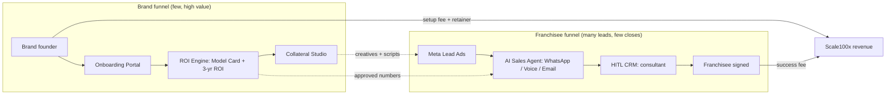
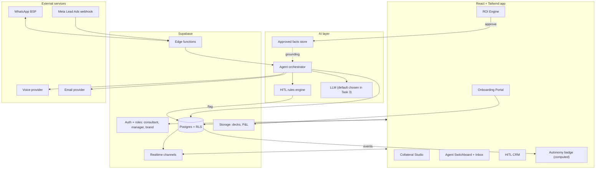
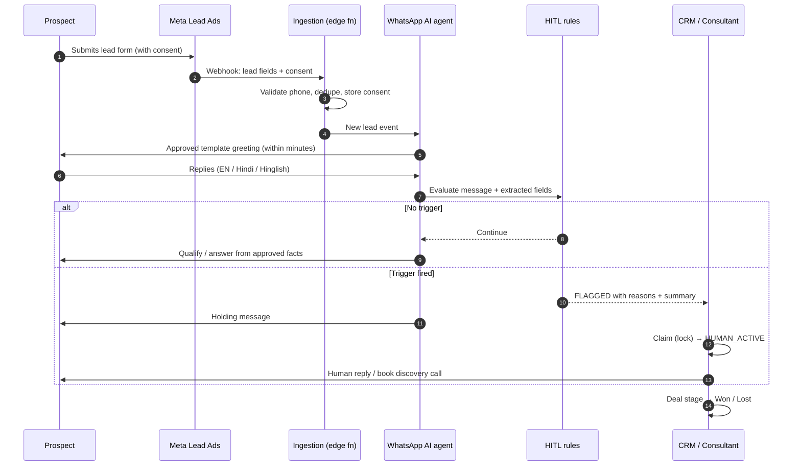
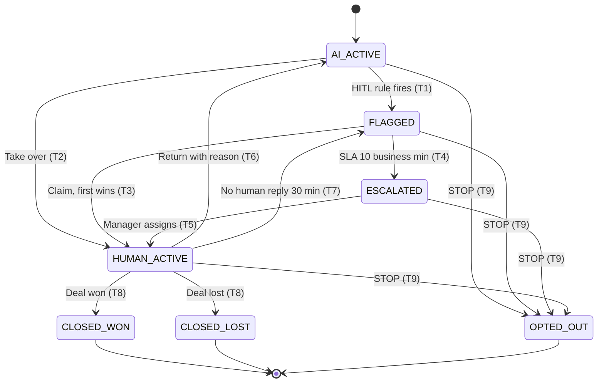
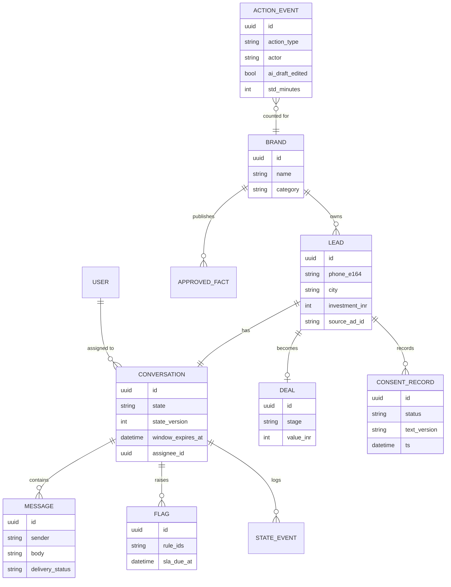
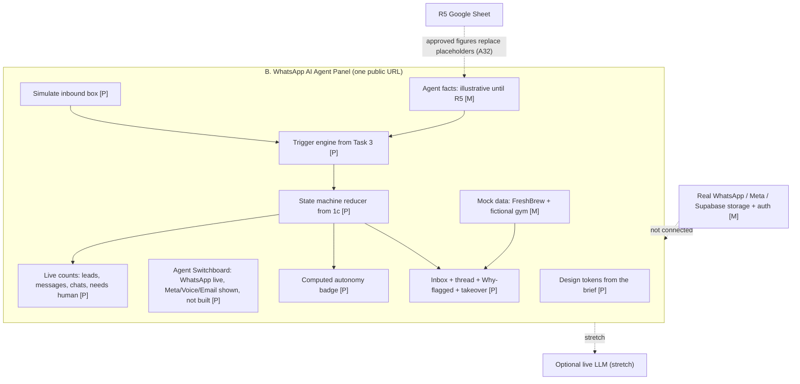
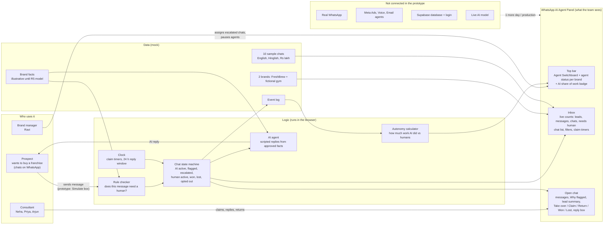
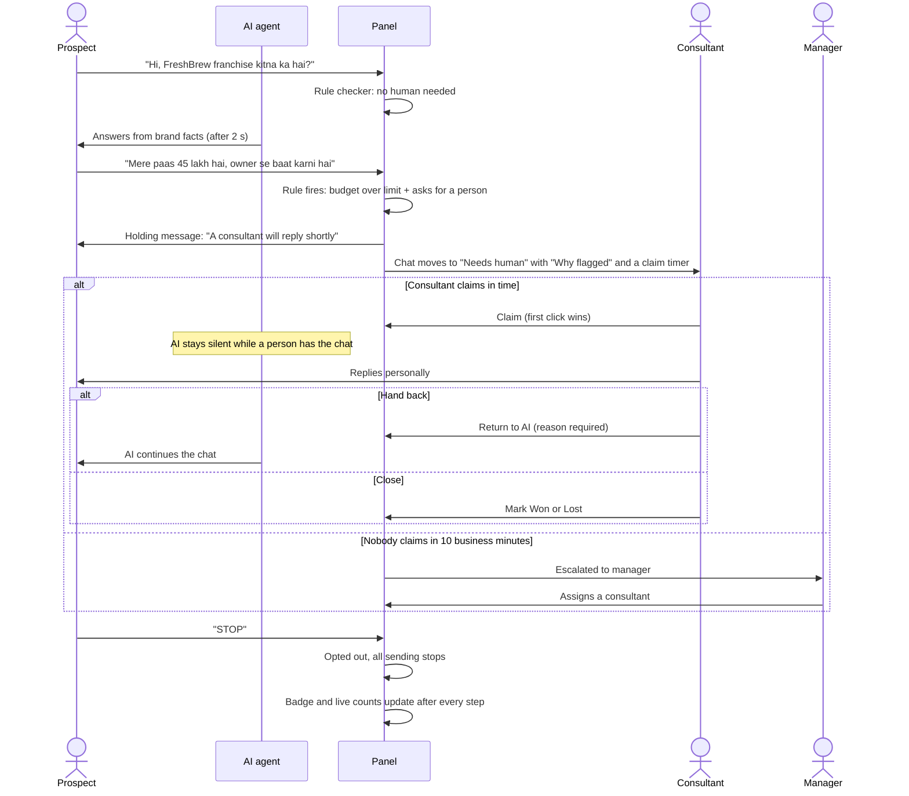
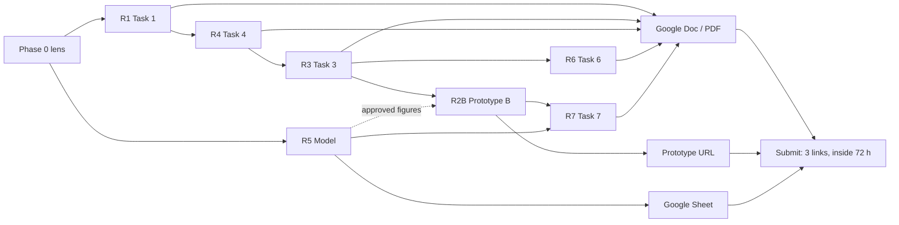

# Architecture sheet: Franchise-in-a-Box OS

One page to understand how the business, the platform, the Task 2 prototype (Option B) and the submission fit together.
The component register is in [`architecture-components.csv`](architecture-components.csv), which can be imported into Google Sheets.
Every diagram below is also saved as a PNG in [`diagrams/`](diagrams/), ready to paste into the Google Doc.

**Legend:** solid arrow = data or control flow · dotted arrow = supplies facts/config · **[P]** = built in a Task 2 prototype · **[M]** = mocked in the prototypes.

---

## 1. Business context: two funnels, one revenue event

**Takeaway:** the brand side earns the right to sell. The franchisee side produces both the revenue and the AI leverage.

## 2. Target platform architecture

## 3. Lead-to-close sequence (also the Task 6A flow)

## 4. Takeover state machine (Task 1c, built in prototype B)

A closed lead who messages again reopens to `AI_ACTIVE` with history kept (edge case 4). This is left out of the diagram for readability.

## 5. Core data model

`ACTION_EVENT` feeds the Autonomy Rate (Task 1b). `state_version` provides the optimistic lock for claims.

## 6. Prototype architecture (Task 2, Option B: what's real vs mocked)

Prototype B is a Vite app built by Claude Code and hosted on Vercel (D-01). Logic runs in the browser with mock data; there is no backend, and the brief's Supabase is not used (A11). Task 2 says "Choose ONE", so Options A (Onboarding Wizard) and C (ROI Dashboard) are not built (D-10).

### 6.1 WhatsApp AI Agent Panel end to end: who uses it and what's inside

Image: [`diagrams/10-panel-end-to-end.png`](diagrams/10-panel-end-to-end.png). The AI handles routine chats, and the rule checker spots when a person is needed. In the prototype the Simulate box plays the prospect and nothing is sent to real WhatsApp.

### 6.2 WhatsApp AI Agent Panel user journey: one chat, end to end

Image: [`diagrams/11-panel-user-journey.png`](diagrams/11-panel-user-journey.png). A consultant claims a flagged chat and the AI goes quiet. If no one claims it in time, the manager is pulled in. The state names and rules come from the takeover state machine in §4.

## 7. Delivery plan (requirements → artefacts)

```mermaid
gantt
  title Sprint plan (relative hours, estimates only)
  dateFormat HH:mm
  axisFormat %H:%M
  todayMarker off
  section Decide
  R1 Product thinking        :r1, 00:00, 90m
  R4 Prioritisation          :r4, after r1, 30m
  R3 Agent design            :r3, after r4, 60m
  R2B Build brief + prompts  :rb, after r3, 30m
  section Build
  R2B Build                  :r2, after rb, 120m
  R2B Ship + write-up        :r2s, after r2, 45m
  R5 Model                   :r5, after r2s, 120m
  Swap R5 figures into B     :lk, after r5, 10m
  section Finish
  R6 Automation + research   :r6, after lk, 60m
  R7 How I work              :r7, after r6, 30m
  R8 Assemble + submit       :r8, after r7, 60m
```

The Gantt shows elapsed hours from the moment you start (~11 h in total). Estimates are for planning only; quality comes first, and the work can span more than one day inside the 72 h deadline (D-07). Breaks aren't drawn.
