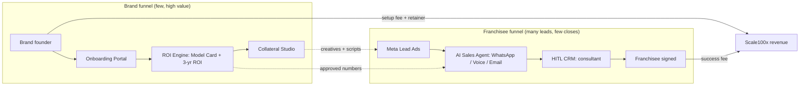
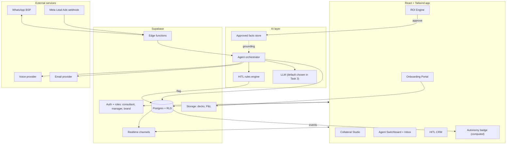
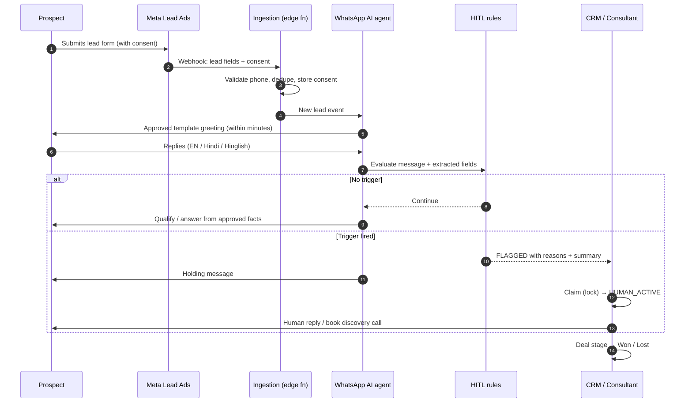
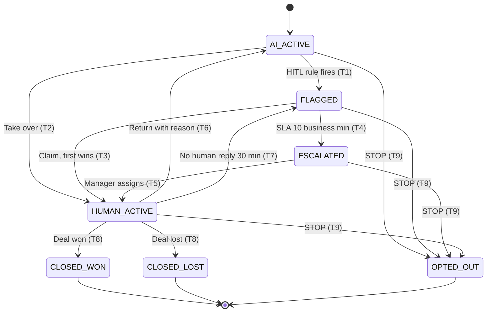
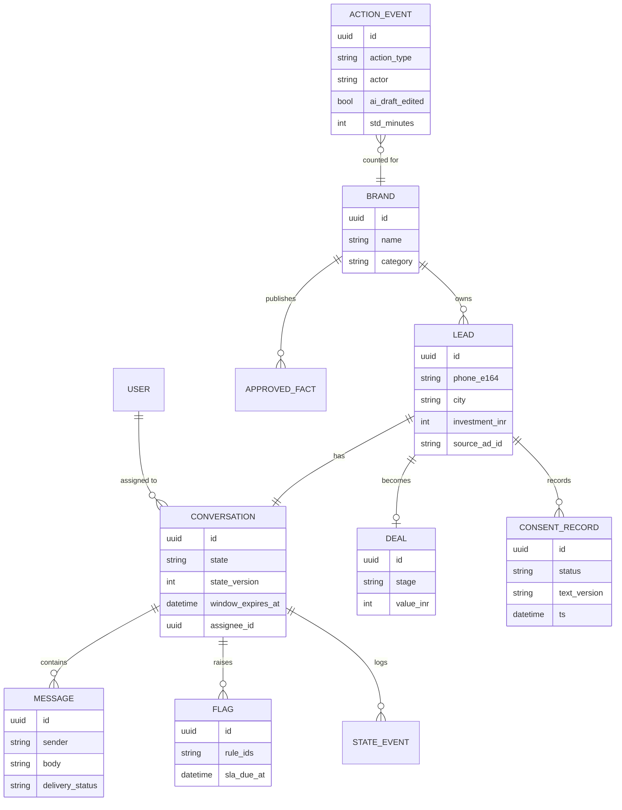
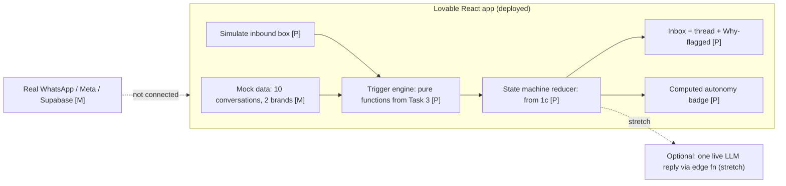
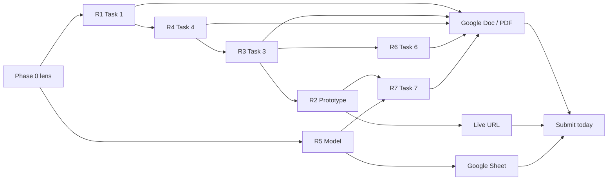

# Architecture sheet: Franchise-in-a-Box OS

One page to understand how the business, the platform, the prototype and the submission fit together.
The component register is in [`architecture-components.csv`](architecture-components.csv), which can be imported into Google Sheets.
Every diagram below is also saved as a PNG in [`diagrams/`](diagrams/), ready to paste into the Google Doc.

**Legend:** solid arrow = data or control flow · dotted arrow = supplies facts/config · **[P]** = built in the Task 2 prototype · **[M]** = mocked in the prototype.

---

## 1. Business context: two funnels, one revenue event

**Takeaway:** the brand side earns the right to sell. The franchisee side produces both the revenue and the AI leverage.

## 2. Target platform architecture

## 3. Lead-to-close sequence (also the Task 6A flow)

## 4. Takeover state machine (Task 1c, built in Task 2)

A closed lead who messages again reopens to `AI_ACTIVE` with history kept (edge case 4). This is left out of the diagram for readability.

## 5. Core data model

`ACTION_EVENT` feeds the Autonomy Rate (Task 1b). `state_version` provides the optimistic lock for claims.

## 6. Prototype architecture (Task 2: what's real vs mocked)

## 7. Delivery plan (requirements → artefacts)

```mermaid
gantt
  title One-day sprint (relative hours, no fixed clock)
  dateFormat HH:mm
  axisFormat %H:%M
  todayMarker off
  section Block A: decide
  R1 Product thinking      :r1, 00:00, 90m
  R4 Prioritisation        :r4, after r1, 30m
  R3 Agent design          :r3, after r4, 60m
  R2 Build brief + prompts :rb, after r3, 30m
  section Block B: build
  R2 Build (freeze 2 h)    :r2, after rb, 120m
  R2 Ship + write-up       :r2s, after r2, 45m
  R5 Model (part 1)        :r5, after r2s, 75m
  section Block C: finish
  R5 Model (part 2)        :r5b, after r5, 45m
  R6 Automation + research :r6, after r5b, 60m
  R7 How I work            :r7, after r6, 30m
  R8 Assemble + submit     :r8, after r7, 60m
```

The Gantt shows elapsed hours from the moment you start. There are no fixed clock times (D-07); breaks aren't drawn.
