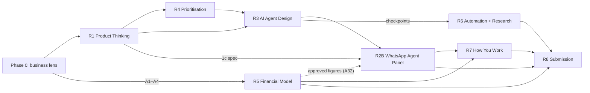

# Requirements: evaluation matrix

Each requirement maps to one task in the brief, plus R8 for the submission rules. Every requirement folder contains:

| File | Purpose |
|---|---|
| `evaluation.md` | What the brief literally asks, what reviewers will actually judge, ambiguities, risks, effort, priority |
| `features.md` | The concrete components of the deliverable, tagged with MoSCoW priority |
| `tasks.md` | Numbered, estimated tasks in execution order |
| `phases.md` | Phase-by-phase plan with entry and exit criteria |
| `definition-of-done.md` | A checklist that must be fully ticked before the requirement counts as done |
| `build-log-template.md` | Prototype folders only: prompt → what AI got wrong → fix, filled in while building |

Task 2 says "Choose ONE", so only **R2B (Option B, WhatsApp AI Agent Panel)** is built (D-10), in Claude Code on Vercel (D-01). R2A and R2C were planned before that decision. Their folders stay as unbuilt plans, each marked "not being built".

## Evaluation summary

| ID | Requirement | Literal ask | What reviewers really judge | Main risk | Est. | Priority |
|---|---|---|---|---|---|---|
| [R1](R1-product-thinking/evaluation.md) | Product Thinking | 30-day modules; AI/Human map; one dev spec | Revenue-driven ranking; challenging the 76% claim; a spec buildable without questions | A generic ranking or a spec missing states and errors | 1.5 h | P0 |
| [R4](R4-prioritisation/evaluation.md) | Prioritisation Under Constraint | Top 4, Month 2 / Cut, QSR variation | Consistency with R1; willingness to cut; a variation that actually changes the order | Answering "no change" to the QSR question | 0.5 h | P1 |
| [R3](R3-ai-agent-design/evaluation.md) | AI Agent Design | 6+ triggers, 150–250 word prompt, model choice + test | Measurable triggers; production-grade prompt; a real eval | Vague triggers; prompt outside the word limit | 1 h | P0 |
| [R2B](R2B-whatsapp-agent-panel/evaluation.md) | Prototype B: WhatsApp AI Agent Panel | Inbox, conversation view, HITL triggers, takeover flow; live URL, prompts, errors, fixes, next day | A working flow, not a static mock; design-system match; specific AI-error log | Static-looking chat; broken link | 2.75 h | P0 |
| [R5](R5-financial-model/evaluation.md) | Financial Model | Monthly P&L Y1, payback, 3-year Scale100x revenue, sensitivity, assumptions | Sourced inputs; franchisee economics kept separate from Scale100x revenue; correct maths | Hardcoded numbers; wrong payback | 2 h | P0 |
| [R2C](R2C-roi-dashboard/evaluation.md) | ~~Prototype C: ROI Dashboard~~ | Not being built (D-10) | — | — | — | — |
| [R2A](R2A-onboarding-wizard/evaluation.md) | ~~Prototype A: Onboarding Wizard~~ | Not being built (D-10) | — | — | — | — |
| [R6](R6-automation-research/evaluation.md) | Automation + Research | 6A lead flow; 6B EV 2W servicing research | Realistic Indian stack; maths shown; dated sources; clear go/no-go | Unsourced market sizes; generic risk | 1 h | P1 |
| [R7](R7-how-you-work/evaluation.md) | How You Work | Tools, self-rating, process, complex problem, ambiguity | Evidence over self-praise; calibration | Listing tools with no proof | 0.5 h | P2 |
| [R8](R8-submission-assembly/evaluation.md) | Submission & Assembly | Doc/PDF, prototype URL, model within 72 h | Skimmability; working links; completeness | A missing deliverable caps the verdict | 1 h | P0 (gate) |

## Dependency graph

**Scope note (R4 → R2B):** prototype B demos Module 4 as the brief describes it, including the Agent Switchboard. R4 ranks what gets built first for production, so a feature can appear in the prototype even though R4 defers it (for example, the Voice and Email agents are Month 2 in the component sheet, so they appear only as switchboard tiles). R4 and R8 both state this.
