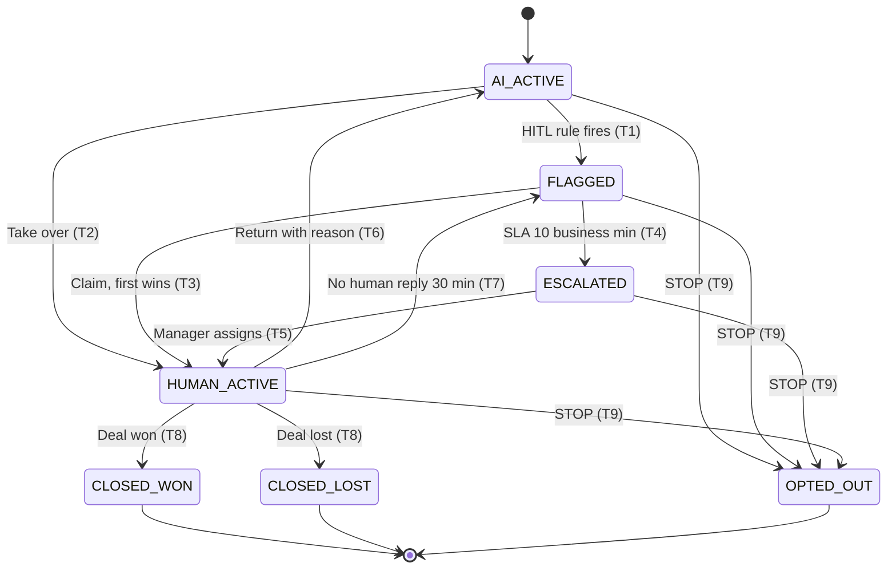

# 1c. Developer-ready spec: Conversation Takeover (Human-in-the-Loop)

> **TL;DR.** The brief gives human takeover one line ("Includes HITL takeover"). This spec makes it buildable without questions: what the screen shows, how a conversation moves between the AI and a person, what happens when something fails, and 11 pass/fail tests, with a 10-business-minute pick-up time (D-06). Its two hard rules: once a person takes over, the AI sends nothing more, and nobody messages a prospect who said stop.

## How we chose this feature

The brief describes several features in one line or less. We asked three questions of each:
1. Is it in the first 30 days ([1a](1a-prioritisation.md))?
2. How much does it cost if a developer guesses wrong?
3. Is the unclear part **what to measure** (which can be tuned later) or **how it behaves** (which has to be right on day one)?

| Feature (as the brief puts it) | What's unclear | In the first 30 days? | Cost of a wrong guess | Unclear part |
|---|---|---|---|---|
| **HITL takeover** | Who owns the chat; two people clicking at once; nobody picking it up; WhatsApp's 24-hour rule; "stop messaging me" | **Yes**, rank 1 | **High**: a lost hot lead, or the AI and a person both replying | **Behaviour** |
| AI Readiness Score | What is scored, the weights, the thresholds | No | Medium: a scoring rubric can be adjusted (A31) | Measurement |
| AI insights | What triggers an insight | No | Medium: misleading advice | Measurement |
| Live call intelligence | What it captures and suggests, and when | No | Medium | Behaviour |
| Meta ads optimisation | What the AI may change without approval | No | High (ad spend), but outside the 30 days | Behaviour |
| Live tracking | Which numbers to show | Yes (basic counts) | Low | Measurement |

Only takeover is in the first 30 days, expensive to get wrong **and** unclear in behaviour. The close runner-up was the Readiness Score (A18): *takeover is harder to build; the Readiness Score is harder to define.* The 1b numbers back this up: 93% of the human hours left after AI (54.6 of 58.8 a month per brand) sit in the CRM, starting with takeovers.

Platform facts (WhatsApp's 24-hour rule, error 131047, the 4,096-character limit) were checked against Meta's documentation; the sources are at the end. The pick-up time and business hours are our product choices, labelled as such (D-06, A22).

## 1. Feature overview

| | |
|---|---|
| **Module** | AI Sales & Marketing Agent (the WhatsApp agent in the 30-day release) |
| **Feature** | Human-in-the-Loop takeover of a live WhatsApp conversation |
| **Objective** | Let a consultant step into any AI conversation safely, at the right moment, without the prospect ever getting two replies, and hand it back to the AI when they're done. |
| **Problem statement** | The AI handles most conversations, but some need a person: a hot lead, a money question, a complaint, or a prospect who asks for a human. Today nothing defines who replies, how fast, or what happens if the AI and a person both act. That risks lost leads, double replies, and messages sent to people who said stop. |
| **Proposed solution** | A clear owner for every conversation at all times (AI, nobody yet, or one named consultant). The AI flags conversations that need a person and explains why. A consultant claims it, and the AI goes quiet. If nobody claims it within 10 business minutes, the manager is alerted. Every step is logged. Separately, the agent itself shows a simple status (Active / Paused / Error), so a team can see whether the AI is really sending, not just switched on. |

**Who uses it**

| As a… | I want to… | So that… |
|---|---|---|
| Consultant | see which conversations need me, why, and how long I have | I reach hot prospects before they go cold |
| Consultant | claim a conversation and know nobody else (AI or person) is replying | the prospect never gets two answers |
| Consultant | hand a conversation back to the AI with a reason | the AI keeps nurturing, and we learn why it flagged |
| Sales manager | be alerted when a flag sits unclaimed too long, and see if the agent is failing | no hot lead is dropped and no outage goes unnoticed |
| Prospect | get a person quickly when I ask, and stop all messages when I say STOP | I trust the brand |

**In the first version:** WhatsApp only; one brand per conversation; one consultant owns a conversation at a time; English, Hindi and Hinglish keyword lists.

**Later (after day 30):** voice and email takeover; a full agent switchboard covering Voice, Email and Meta Ads; automatic round-robin assignment; routing by consultant skill.

## 2. UI behaviour

### A. Agent status (top of the inbox)

The **agent's** status is kept separate from each **conversation's** status. "The AI is switched on" and "the AI is actually sending" are not the same thing, and a team needs to see both.

| Agent status | What it means | What the screen shows |
|---|---|---|
| **Active** | The WhatsApp agent is on and messages are going out | Green dot, "Active", and the time of the last successful send |
| **Paused** | A manager has paused the agent for this brand (or WhatsApp access isn't approved yet) | Grey dot, "Paused by Ravi at 10:14". Every new message goes to a person (see edge case 9). |
| **Error** | The agent is switched on but messages are **not** going out | Red dot, "Error: messages not sending since 10:20", with the last error in plain words and a **Retry check** button |

The status strip shows "Enabled" and "Last successful send" side by side, so "on but failing" can't hide. Only a manager can pause or resume the agent.

### B. Inbox and live conversation

- **Each inbox row shows:** prospect name or number, brand tag, last message, and a coloured status chip: AI (blue `#2563EB`), Needs a human / Escalated (amber `#F59E0B`), Human (green `#10B981`), Closed / Opted out (grey).
- **"Needs human" filter:** shows conversations waiting for a person, most urgent first. A countdown shows the time left to pick it up; it turns red under 2 minutes.
- **New flags appear** on every consultant's screen within 2 seconds, without refreshing.
- **The thread** shows prospect, AI and human messages, plus system notes in line: "Flagged: high intent", "Claimed by Priya", "AI reply cancelled: Priya took over", "Returned to AI: question answered".

### C. Human takeover

**Buttons in the conversation header** (the header also shows the assignee and how long is left in WhatsApp's 24-hour reply window):

| Conversation status | Buttons shown |
|---|---|
| AI handling | **Take over** |
| Needs a human | **Claim** |
| Escalated | **Claim** (managers also see **Assign**) |
| Human handling | **Return to AI**, **Mark Won**, **Mark Lost** |
| Won / Lost / Opted out | None (read-only) |

**"Why flagged" card.** Pinned at the top while the conversation waits for a person. It lists every reason in plain words with the actual value, e.g. *Deal value: stated investment ₹45L, brand threshold ₹32L*; *Asked for a person: "call me"*.

**Takeover panel** (right side, once a consultant owns the chat): a 5-point AI summary (budget, city, timeline, objections, last unanswered question), the lead score, and one suggested reply. The suggestion goes into the message box only when clicked and is **never sent automatically**.

**Message box**

| Situation | Message box |
|---|---|
| AI handling | Locked: "AI is handling this conversation. Take over to reply." |
| Human handling | Open, with an "AI paused" banner and a character counter (`n / 4,096`) |
| More than 24 h since the prospect's last message | Free typing is locked; a picker of approved WhatsApp templates appears |
| Won / Lost / Opted out | Hidden; read-only thread |

## 3. State transitions

**Conversation states** (system code in brackets, for developers):

| State | Who may send | Meaning |
|---|---|---|
| AI handling (`AI_ACTIVE`) | AI only | The default. The AI qualifies and answers from approved facts. |
| Needs a human (`FLAGGED`) | Nobody (the AI has sent one holding message) | A takeover rule fired. Waiting for a consultant. The 10-minute clock is running. |
| Escalated (`ESCALATED`) | Nobody | Nobody claimed it in time. The manager has been alerted. |
| Human handling (`HUMAN_ACTIVE`) | The assigned consultant only | The AI is silent in this conversation. |
| Won / Lost (`CLOSED_WON` / `CLOSED_LOST`) | Nobody (final) | Deal closed. |
| Opted out (`OPTED_OUT`) | Nobody, not even templates (final) | The prospect asked us to stop. |

**How a conversation moves**

"Only if" is the check the system makes before the change. If the check fails, nothing changes and the person sees why.

| # | Current state | Trigger | Only if | Next state | Expected behaviour |
|---|---|---|---|---|---|
| T1 | AI handling | A prospect message matches at least one takeover rule (Task 3) | The agent is Active for this brand (if not, edge case 9 applies) | Needs a human | The flag lists every rule that fired and why. The AI sends **one** holding message and nothing else. The 10-business-minute clock starts. On-duty consultants are notified. |
| T2 | AI handling | A consultant clicks **Take over** (no flag needed) | They work on this brand, and the conversation hasn't changed since they looked | Human handling | The conversation is assigned to them; the AI goes silent; **any AI reply already queued is cancelled**; a note "AI paused" appears in the thread. |
| T3 | Needs a human | A consultant clicks **Claim** | They work on this brand, and nobody claimed it first | Human handling | First click wins. The clock stops and the claim time is recorded. Any queued AI reply is cancelled. |
| T4 | Needs a human | 10 business minutes pass | Still unclaimed (only business hours count) | Escalated | The brand's manager gets an in-app and email alert; the conversation goes to the top of their queue. |
| T5 | Escalated | The manager assigns a consultant or claims it | The person acting is this brand's manager, and the assignee works on this brand | Human handling | Assigned; the time it spent escalated is recorded. |
| T6 | Human handling | The consultant clicks **Return to AI** | A reason is chosen, every legal or money flag is marked resolved, and the message box is empty | AI handling | The reason is logged. The AI replies again from the next prospect message. |
| T7 | Human handling | 30 business minutes pass after a prospect message | No consultant reply since that message | Needs a human | Re-flagged as "No human reply" with a new clock. The original consultant gets the first 2 minutes to claim it back, then anyone can. |
| T8 | Human handling | The consultant marks the deal **Won** or **Lost** | For Lost, a loss reason is chosen | Won / Lost | The deal record closes and the message box locks. |
| T9 | Any open state | The prospect sends "STOP", "unsubscribe", "band karo" or "message mat karo" | The whole message is the keyword (any capitals, spaces trimmed) | Opted out | One confirmation is sent, the only message allowed. All sending is blocked, templates included. Consent is recorded as withdrawn. Any clock is cancelled. |

Behind every change the system adds 1 to the conversation's version number (`state_version`) and writes a log row: who, from, to, why, when. Every button sends the version it saw; if someone else changed the conversation first, the server refuses (HTTP 409) and nothing changes. This is how "first click wins" and "no double replies" are enforced.

**Agent status changes** (separate from the conversation states above)

| Current | Trigger | Only if | Next | Expected behaviour |
|---|---|---|---|---|
| Active | A manager clicks **Pause agent** | The person is this brand's manager | Paused | No AI messages for this brand; new prospect messages go to "Needs a human" (edge case 9) |
| Paused | A manager clicks **Resume** | The person is this brand's manager, and WhatsApp access is approved | Active | The AI handles new messages; conversations already with a person stay with them |
| Active | Sends keep failing (proposed: 3 in a row), or the WhatsApp provider reports the connection is down | Automatic | Error | Red status; the manager is alerted; new prospect messages go to "Needs a human" so no lead waits on a broken AI |
| Error | A send or health check succeeds | Automatic | Active | Status turns green; the outage start and end times are logged |

**Business hours:** 09:00–21:00 IST, every day, in the first version. This can be changed per brand and is our product choice (A22, D-06). A flag raised outside those hours starts its clock at 09:00.

**Holding message** (English shown; Hindi and Hinglish versions are also stored):
> "Thanks, a member of our franchise team will reply to you here shortly." Outside hours, "shortly" becomes "after 9 am".

The holding message is only an acknowledgement, so it does **not** count as the first meaningful reply in the speed-to-lead target ([1a §8](1a-prioritisation.md#8-day-30-success-criteria)). That clock stops at the consultant's first real reply.

## 4. Error handling

| Scenario | Expected behaviour |
|---|---|
| **An AI reply is queued when a consultant takes over** | Just before any AI message is sent, the system re-checks that the conversation is still "AI handling". If not, the message is cancelled, never sent, and logged as "AI reply cancelled: human took over". |
| **Two consultants claim at the same moment** | The first click wins. The second sees "Already claimed by Priya at 14:02" and their screen updates to show Priya as owner. Nothing else changes. |
| **The same consultant clicks Take over or Claim twice** (double-click, slow network) | Treated as one request: one assignment, one log entry, no error shown. |
| **Takeover fails** (network or server error) | The conversation stays in its previous state, so the AI is not silenced with nobody in charge. The consultant sees "Couldn't take over. Try again." A retry is safe and can't create a second assignment. |
| **Return to AI fails** | The conversation stays with the consultant, who sees "Couldn't hand back. You still own this conversation." A retry is safe. |
| **A message fails to send** (WhatsApp provider error, or no answer within 10 s) | The bubble turns red, "Not delivered", with **Retry**. The text is kept. A retry can't send the message twice. After 3 failed retries the conversation is flagged "Delivery problem". |
| **The WhatsApp connection is down** | The agent status turns **Error** and the manager is alerted. Failed sends are logged as failures and **never counted as AI work done** (they don't raise the Autonomy Rate). New prospect messages go to a person. |
| **More than 24 hours since the prospect's last message** | Free typing is replaced by the template picker: "More than 24 h since the prospect's last message. Send an approved template." If WhatsApp still returns error 131047, the bubble says "Window closed. Send a template." Free text is never retried automatically. |
| **The live connection drops** | Banner: "Reconnecting… messages may be out of date". **Send** is disabled until the screen is up to date again, so nobody replies to an old view. |
| **The prospect writes again while waiting for a person** | The new message shows in the thread; the "Why flagged" card updates if more rules fire. No second holding message; the clock does not restart. |
| **Nothing needs a person** | "No conversations need you right now", plus how many the AI is handling. |
| **Screens loading** | Grey placeholder rows and bubbles, not a full-page spinner. The last 50 messages load first; older ones load on scroll. |

### Edge cases

1. **A flag fires at 20:58.** About 2 business minutes count today; the clock resumes at 09:00. The holding message says "after 9 am".
2. **Several rules fire on one message.** One flag lists every reason. There is never more than one flag per message.
3. **A closed lead messages again.** A new cycle starts in "AI handling", with the full history kept and the previous outcome shown in the header.
4. **STOP during a human conversation.** T9 applies: the message box locks and the consultant sees "Prospect opted out". Only the prospect sending "START" can re-open it, which records new consent.
5. **The consultant goes offline mid-conversation.** If the prospect's message sits unanswered for 30 business minutes, T7 re-flags it.
6. **The 24-hour window closes while the consultant is typing.** The draft is kept; Send becomes "Send as template"; nothing goes out as free text.
7. **The assigned consultant's account is deactivated.** Their conversations are re-flagged at once as "Assignee unavailable".
8. **A consultant takes over just as the AI's reply is about to go.** The pre-send check cancels the AI reply (see above). The prospect sees only the consultant's message.
9. **The AI is paused or in Error for a brand.** This covers the period before WhatsApp approval arrives (the fallback in [1a §6](1a-prioritisation.md#6-day-1-critical-path-whatsapp-access)), a manager pausing the agent, and an outage. Every new prospect message goes straight to "Needs a human" with reason "AI off for brand". The same 10-minute rule applies; the AI sends nothing except the holding message, and in Error not even that.
10. **The same prospect arrives again as a new lead.** A Lead Ads form whose phone number matches an open conversation for the same brand is added to that conversation's timeline. It doesn't create a second conversation or change its state.

### Validation rules

| Field or action | Rule |
|---|---|
| Message text | 1–4,096 characters after trimming; blank messages are rejected. 4,096 is WhatsApp's limit ([Meta text messages](https://developers.facebook.com/docs/whatsapp/api/messages/text/)). |
| Any button that changes the state | Must carry the version number (`state_version`) the user saw; if it's out of date the server refuses (HTTP 409) |
| Take over / Claim | Must carry a request ID, so a repeated click is treated as the same request |
| Return to AI | A reason is required: *Question answered* / *Not ready, keep nurturing* / *Wrong flag* / *Other* (5–200 characters). Every legal or money flag must be marked resolved first. |
| Mark Lost | A loss reason from a fixed list |
| Template send | Every template field filled; only templates WhatsApp has **approved** are listed |
| Any send | Blocked if the prospect opted out, the conversation is closed, or (for AI sends) it is no longer "AI handling" |
| Who can act | Only consultants or managers of that brand can see, claim or take over its conversations (row-level security); only managers can pause the agent |

## 5. Success criteria

### Functional acceptance (pass/fail tests)

| # | Situation | Passes when |
|---|---|---|
| AC1 | AI handling; a prospect message matches at least one rule | "Needs a human" within **2 s** (95% of the time). The card lists **every** rule that fired, with its value. Exactly **1** holding message, then **0** AI messages. |
| AC2 | Two consultants claim the same flag within **500 ms** | Exactly **1** succeeds. The other sees the "already claimed" notice within **1 s**. The version number goes up by exactly **1**. |
| AC3 | A flag nobody claims | Escalated at **10 business minutes** (± 30 s) and the manager is alerted. A flag raised outside hours escalates at **09:10** at the earliest. |
| AC4 | Human handling; Return to AI with no reason, or with an unresolved legal/money flag | The button stays disabled. **0** state changes. |
| AC5 | Message box holds **4,097** characters | Send is disabled and the counter is red. At **4,096** it sends. |
| AC6 | More than 24 h since the prospect's last message | Free typing is locked and the template picker shows. An error 131047 marks the bubble failed, with **0** automatic free-text retries. |
| AC7 | "STOP" or "band karo" in any open state | Opted out within **2 s**. **0** messages afterwards, templates included. Consent is recorded as withdrawn. |
| AC8 | Human handling; the prospect's message goes unanswered | Re-flagged "No human reply" at **30 business minutes** (± 30 s). |
| AC9 | An AI reply is queued, then a consultant takes over before it sends | **0** AI messages reach the prospect after the takeover. The cancelled reply is logged. |
| AC10 | The same Take over / Claim is sent twice, or a takeover or Return to AI fails | Exactly **1** assignment and **1** log entry for a repeat. After a failure the conversation is in its previous state, and a retry succeeds without duplicates. |
| AC11 | Sends to WhatsApp fail (simulated outage) | Agent status shows **Error** within **60 s** (proposed); the manager is alerted; the failed sends are logged as failures, with **0** counted as completed AI work. |

Prototype B's test script runs AC1, AC2, AC4, AC5, AC7, AC9 and AC10 directly. AC3 and AC8 use a shortened timer in the demo; AC6 and AC11 are simulated.

### Pilot metrics (after launch)

Targets are proposals, to be set properly once the 2-brand pilot has a baseline.

| Metric | Proposed target | Where it comes from |
|---|---|---|
| **Takeover success rate:** takeovers that ended with the consultant in charge and the AI silent, out of all attempts | ≥ 99% | Conversation log |
| **AI messages after a takeover** (the AI sent something after a person took charge) | 0 | Message log |
| Flags claimed within 10 business minutes | ≥ 90% in month 1, ≥ 95% by month 3 | Flag and claim times |
| Median time to claim | ≤ 5 business minutes | Conversation log |
| Median time from flag to the consultant's first real reply | ≤ 10 business minutes | Message log |
| **Integration reliability:** share of the time the agent is Active while switched on, and sends delivered on the first try | Baseline in month 1 | Agent status log, send log |
| **Human handling time vs baseline:** consultant minutes per takeover, compared with handling the same chat by phone before the pilot | Baseline in days 1–5 ([1b §6](1b-ai-human-split.md#6-validating-76-the-pilot-plan)); goal: lower | Conversation log, baseline timings |
| Missed escalations found in the weekly 50-conversation audit ([1b](1b-ai-human-split.md#audit)) | ≤ 5% | Audit sheet |
| "Wrong flag" share of Return-to-AI reasons | Tracked; above 30% triggers a review of the rules | Flag reasons |
| Takeovers that lead to a booked discovery call | Baseline in month 1; no target until we have data | Deal stage |

## 6. Definition of done

The feature is done when:
- [ ] All 11 acceptance tests pass on a scripted test set.
- [ ] Automated tests cover the risky paths: a failed takeover, a failed Return to AI, a queued AI reply at takeover, a repeated request, and the AI and a person acting at the same moment.
- [ ] Every state change, cancelled AI reply and failed send writes a log entry, and the events below reach the Autonomy Rate.
- [ ] The agent status (Active / Paused / Error) is visible, and the manager alert has been tested with a simulated outage.
- [ ] Holding and opt-out messages exist in English, Hindi and Hinglish, and the consultants who will use it have reviewed them.
- [ ] Only that brand's consultants and managers can see or act on its conversations (checked with a user from another brand).
- [ ] **Controlled rollout:** switched on for the 2 pilot brands only (A21), watched daily for the first week against the pilot metrics, with a manager able to pause the agent at any time. Wider rollout only after 2 weeks with 0 AI messages after a takeover and 0 messages to opted-out prospects.

## Events this feature writes (for the Autonomy Rate)

Each step writes an `ACTION_EVENT` ([1b §5](1b-ai-human-split.md#event-schema)). This is how the steps count toward the badge:

| Step | Action map row | Done by (`actor`) | Counts as |
|---|---|---|---|
| Detect the rule and raise the flag (T1) | 29 Detect HITL triggers | `ai_model` | AI. It becomes human if the weekly audit finds a missed escalation. |
| Send the holding message | 23-style template | `software` | Automation, shown as software rules, not AI |
| Build the takeover summary | 32 Summarise lead | `ai_model` | AI |
| Consultant replies, including a suggested reply sent unedited | 33 Take over and reply | `human` | Human. A takeover is human work by definition (1b's unedited rule applies to AI-drafted actions a human approves, not to takeovers). |
| Mark Won / Lost (T8) | 37 Update deal stage | `human` (confirms an AI suggestion) | AI only if the suggested stage is accepted unchanged |
| An AI send that failed or was cancelled | — | `ai_model` or `software` | Logged as failed or cancelled. **Never** counted as completed work. |

## Platform facts used (verified)
- **24-hour window and error 131047:** "More than 24 hours have passed since the recipient last replied to the sender number. Send the recipient a template message instead." ([Meta error codes](https://developers.facebook.com/docs/whatsapp/cloud-api/support/error-codes), checked 15 Oct 2026).
- **Text message limit:** 4,096 characters ([Meta text messages](https://developers.facebook.com/docs/whatsapp/api/messages/text/); also stated in [360dialog's docs](https://docs.360dialog.com/partner/messaging/message-types/text-messages)).
