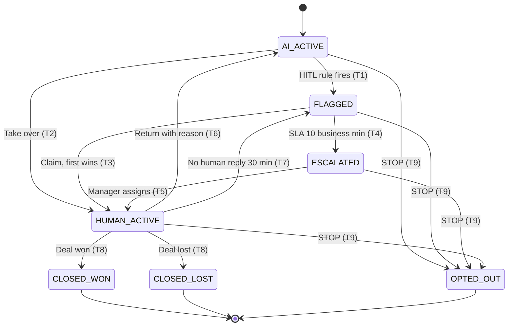

# 1c. Developer-ready spec: Conversation Takeover (HITL)

> **TL;DR.** The brief describes human takeover in four words: "Includes HITL takeover". That one line hides the hardest behaviour in the product: who owns a live WhatsApp conversation, what happens when two people grab it, and what happens when nobody does. This spec defines 7 states and 9 transitions, a 10-business-minute claim SLA (D-06), the WhatsApp 24-hour window, opt-out, 8 edge cases and 8 testable acceptance criteria. Prototype B (R2B) implements it.

## Why this feature, not the AI Readiness Score

The Readiness Score is unclear too, but the uncertainty is in *what to measure*: a rubric that can be iterated on (prototype A shows one, A31). Takeover is unclear in *how it behaves*, and mistakes there are costly. A missed handover loses a ready-to-buy prospect, and a double reply from both AI and a human damages trust. It also sits on the revenue path (1a, rank 1), so it's the feature that most needs a precise spec.

## 1. Users and stories

| As a… | I want to… | So that… |
|---|---|---|
| Consultant | see which conversations need me, why, and how long I have | I reach high-intent prospects before they go cold |
| Consultant | claim a conversation and know nobody else is replying | the prospect never gets two answers |
| Consultant | hand a conversation back to the AI with a reason | the AI keeps nurturing, and we learn why the flag fired |
| Sales manager | be alerted when a flag sits unclaimed past the SLA | no hot lead is dropped |
| Prospect | get a human reply quickly when I ask for one, and stop messages when I say STOP | I trust the brand |

**v1 scope:** WhatsApp only, a single brand per conversation, one consultant owns a conversation at a time, and English / Hindi / Hinglish keyword lists.

**Not in v1:** voice and email takeover, round-robin auto-assignment, consultant skill routing.

## 2. States

| State | Who may send messages | Meaning |
|---|---|---|
| `AI_ACTIVE` | AI only | Default. The AI qualifies and answers from approved facts. |
| `FLAGGED` | Nobody (the AI has sent one holding message) | A HITL rule fired. Waiting for a consultant to claim it. The SLA clock is running. |
| `ESCALATED` | Nobody | Unclaimed past the SLA. The manager is alerted. |
| `HUMAN_ACTIVE` | The assigned consultant only | The AI is paused for this conversation. |
| `CLOSED_WON` | Nobody (terminal) | Deal won. |
| `CLOSED_LOST` | Nobody (terminal) | Deal lost. |
| `OPTED_OUT` | Nobody, including templates (terminal) | The prospect sent STOP. |

## 3. Transitions

Every transition increments `conversation.state_version` and writes a `STATE_EVENT` row (who, from, to, reason, ts).

| # | From → To | Trigger | Guard | System action |
|---|---|---|---|---|
| T1 | AI_ACTIVE → FLAGGED | An inbound message fires ≥ 1 HITL rule (Task 3 triggers) | Not opted out | Create `FLAG` with every fired `rule_id` and the values that fired; set `sla_due_at` = now + 10 business min; AI sends **one** holding message; notify on-duty consultants |
| T2 | AI_ACTIVE → HUMAN_ACTIVE | Consultant clicks **Take over** without a flag | User role is consultant or manager; `state_version` matches | Assign to the user; AI paused; "AI paused" system note in the thread |
| T3 | FLAGGED → HUMAN_ACTIVE | Consultant clicks **Claim** | `state_version` matches (first claim wins) | Assign; stop the SLA clock; record claim time |
| T4 | FLAGGED → ESCALATED | `sla_due_at` passes (business minutes only) | Still unclaimed | Notify the brand's manager (in-app + email); conversation moves to the top of the manager's queue |
| T5 | ESCALATED → HUMAN_ACTIVE | Manager assigns a consultant, or claims it | `state_version` matches | Assign; record the escalation duration |
| T6 | HUMAN_ACTIVE → AI_ACTIVE | Consultant clicks **Return to AI** | A reason is selected; every compliance flag (legal / financial) is marked **Resolved**; the composer is empty | AI resumes on the next inbound message; the reason is stored on the flag |
| T7 | HUMAN_ACTIVE → FLAGGED | Prospect's last message is unanswered for 30 business minutes | Last message is from the prospect | New flag, reason "No human reply"; new SLA clock; the original assignee keeps first claim for 2 minutes, then anyone can claim |
| T8 | HUMAN_ACTIVE → CLOSED_WON / CLOSED_LOST | Consultant sets the deal stage to Won or Lost | Lost requires a loss reason | Close the deal record; lock the composer |
| T9 | any non-terminal → OPTED_OUT | Inbound "STOP", "unsubscribe", "band karo", "message mat karo" (case-insensitive, exact-message match) | — | Send one confirmation (the only permitted message); write `CONSENT_RECORD` = withdrawn; block all sends, including templates; cancel the SLA clock |

**Business minutes:** 09:00–21:00 IST, every day in v1. This is configurable per brand and is a product choice (A22, D-06). A flag raised outside those hours starts its clock at 09:00, and the holding message tells the prospect when to expect a reply.

**Holding message (EN; HI and Hinglish versions are also stored):**
> "Thanks, a member of our franchise team will reply to you here shortly." Outside hours, "shortly" becomes "after 9 am".

## 4. UI behaviour

**Inbox (left column)**
- Each row shows: prospect name or number, brand tag, last message preview, and a state chip:
  - AI: blue `#2563EB`
  - Flagged / Escalated: amber `#F59E0B`
  - Human: green `#10B981`
  - Closed / Opted out: grey
- The **Needs human** filter shows FLAGGED and ESCALATED conversations, sorted by SLA time remaining, earliest due first.
- The SLA countdown is shown in mono type and turns red under 2 minutes.
- New flags reach every open session within 2 seconds through realtime.

**Conversation header**
- Prospect name, brand, state chip, assignee avatar, and the 24-hour window countdown (`window_expires_at`).
- Buttons by state:

| State | Buttons shown |
|---|---|
| AI_ACTIVE | **Take over** |
| FLAGGED | **Claim** |
| ESCALATED | **Claim** (managers also see **Assign**) |
| HUMAN_ACTIVE | **Return to AI**, **Mark Won**, **Mark Lost** |
| Terminal states | None |

**"Why flagged" card** (pinned at the top of the thread while FLAGGED / ESCALATED, collapsible afterwards)
- Lists each fired rule by name, with the exact value that fired. Example: *Deal value: stated investment ₹45L ≥ brand threshold ₹40L*; *Explicit request: "call me"*.

**Takeover panel** (right column, HUMAN_ACTIVE)
- A 5-bullet AI summary: budget, city, timeline, objections, last unanswered question.
- The lead score and one suggested reply. The suggested reply is inserted into the composer only on click and is never auto-sent.

**Composer**

| State | Composer behaviour |
|---|---|
| AI_ACTIVE | Disabled. Placeholder: "AI is handling this conversation. Take over to reply." |
| HUMAN_ACTIVE | Enabled, with an "AI paused" banner and a character counter (`n / 4,096`) |
| Window closed | Free text is disabled and replaced by a template picker |
| Terminal states | Hidden. Read-only thread. |

**Thread**
- Shows prospect, AI and human bubbles, plus system events inline: "Flagged: high intent", "Claimed by Priya", "Returned to AI: question answered".

## 5. Empty, loading and error states

| Situation | What the user sees | System behaviour |
|---|---|---|
| Queue empty | "No conversations need you right now." plus the count currently handled by AI | — |
| Loading inbox or thread | Skeleton rows / bubbles; no spinners on the whole page | Thread loads its last 50 messages, then more on scroll |
| **Send failure** (BSP error or timeout > 10 s) | Bubble marked red "Not delivered", with **Retry** | Text stays in the bubble; Retry reuses the same `client_message_id`, so it can't send twice; at most 3 retries, then the conversation is flagged "Delivery problem" |
| **Out-of-window send** | Composer swaps to the template picker: "More than 24 h since the prospect's last message. Send an approved template." | If the API still returns error **131047**, the bubble shows "Window closed. Send a template." and free text is never retried automatically |
| **Claim conflict** | Toast: "Already claimed by Priya at 14:02". The view refreshes to their ownership. | Server rejects the stale `state_version` (HTTP 409); no state change |
| **Realtime disconnect** | Banner: "Reconnecting… messages may be out of date". **Send** is disabled until reconnected. | Resubscribes with backoff; on reconnect, refetches the state and messages since the last event id |
| Prospect messages while FLAGGED | The new message appears in the thread and the Why-flagged card updates if more rules fire | No second holding message; the SLA clock doesn't reset |

## 6. Validation rules

| Field / action | Rule |
|---|---|
| Message body | 1–4,096 characters after trimming; whitespace-only is rejected. 4,096 is the WhatsApp text limit ([Meta text messages](https://developers.facebook.com/docs/whatsapp/api/messages/text/)). |
| Any state-changing action | Must send the current `state_version`; a mismatch returns 409 |
| Return to AI | A reason is required: *Question answered* / *Not ready, keep nurturing* / *Wrong flag* / *Other* (if Other, free text of 5–200 characters). Every compliance flag must be Resolved first. |
| Mark Lost | A loss reason is required from a fixed list |
| Template send | Every template variable must be filled; only templates with status **approved** are listed |
| Any send | Blocked if `CONSENT_RECORD.status` = withdrawn, or the state is terminal |
| Claim / Take over | Role must be consultant or manager for that brand (row-level security) |

## 7. Edge cases

1. **Two consultants claim at the same moment.** The first write wins through `state_version`. The second sees the claim-conflict toast.
2. **A flag fires at 20:58 IST.** About 2 business minutes count today, and the clock resumes at 09:00. The holding message says "after 9 am".
3. **Several rules fire on one message.** One flag lists every reason; there are never duplicate flags for the same message.
4. **A closed lead messages again.** A new conversation cycle opens in `AI_ACTIVE` with the full history kept, and the previous outcome is shown in the header.
5. **STOP during a human conversation.** T9 applies: the composer locks and the human sees "Prospect opted out". Only an inbound "START" can re-open the conversation, which writes a new consent record.
6. **The consultant goes offline mid-conversation.** If the prospect's message sits unanswered for 30 business minutes, T7 re-flags it.
7. **The window expires while the consultant is typing.** The draft is kept, Send switches to "Send as template", and nothing is sent as free text.
8. **The assignee is deactivated.** Their HUMAN_ACTIVE conversations re-flag immediately with reason "Assignee unavailable".

## 8. Acceptance criteria (testable)

| # | Given / when | Then (measurable) |
|---|---|---|
| AC1 | AI_ACTIVE, an inbound message matches ≥ 1 rule | State is FLAGGED within **2 s** (p95). The card lists **every** fired rule with its value. Exactly **1** holding message is sent and **0** further AI messages follow. |
| AC2 | Two claims on the same flag within **500 ms** | Exactly **1** succeeds. The other user sees the conflict toast within **1 s**. `state_version` increases by exactly **1**. |
| AC3 | FLAGGED, unclaimed | Becomes ESCALATED at **10 business minutes** (± 30 s) and the manager is notified. A flag raised outside hours escalates at **09:10** at the earliest. |
| AC4 | HUMAN_ACTIVE, Return to AI with no reason or an unresolved compliance flag | The button stays disabled. **0** state changes. |
| AC5 | Composer has **4,097** characters | Send is disabled and the counter is red. At **4,096** it sends. |
| AC6 | > 24 h since the last inbound message | Free text is disabled and the template picker is shown. A **131047** response marks the bubble failed, with **0** automatic free-text retries. |
| AC7 | "STOP" or "band karo" in any non-terminal state | OPTED_OUT within **2 s**. **0** messages are sent afterwards, templates included. A consent record is written. |
| AC8 | HUMAN_ACTIVE, the prospect's message is unanswered | Re-flagged as "No human reply" at **30 business minutes** (± 30 s). |

Prototype B's test script covers AC1, AC2, AC4, AC5 and AC7 directly. AC3 and AC8 use a shortened timer in the demo, and AC6 is simulated.

## 9. Success metrics after launch

| Metric | Target (proposed, to be calibrated in the pilot) | Source |
|---|---|---|
| Flags claimed within the SLA | ≥ 90% in month 1, ≥ 95% by month 3 | `FLAG.sla_due_at` vs the claim `STATE_EVENT` |
| Median time to claim | ≤ 5 business minutes | `STATE_EVENT` |
| Missed-escalation rate (weekly 50-conversation audit, [1b](1b-ai-human-split.md#audit)) | ≤ 5% | Audit sheet |
| Double replies (AI and human within 60 s of each other) | 0 | `MESSAGE` log |
| "Wrong flag" share of Return-to-AI reasons | Tracked; above 30% triggers a review of the rule thresholds | Flag reasons |
| Takeovers that reach a booked discovery call | Baseline in month 1; no target until we have data | `DEAL` stage |

## Platform facts used (verified)
- **24-hour window and error 131047:** "More than 24 hours have passed since the recipient last replied to the sender number. Send the recipient a template message instead." ([Meta error codes](https://developers.facebook.com/docs/whatsapp/cloud-api/support/error-codes), checked 15 Oct 2026).
- **Text message limit:** 4,096 characters ([Meta text messages](https://developers.facebook.com/docs/whatsapp/api/messages/text/); also stated in [360dialog's docs](https://docs.360dialog.com/partner/messaging/message-types/text-messages)).
