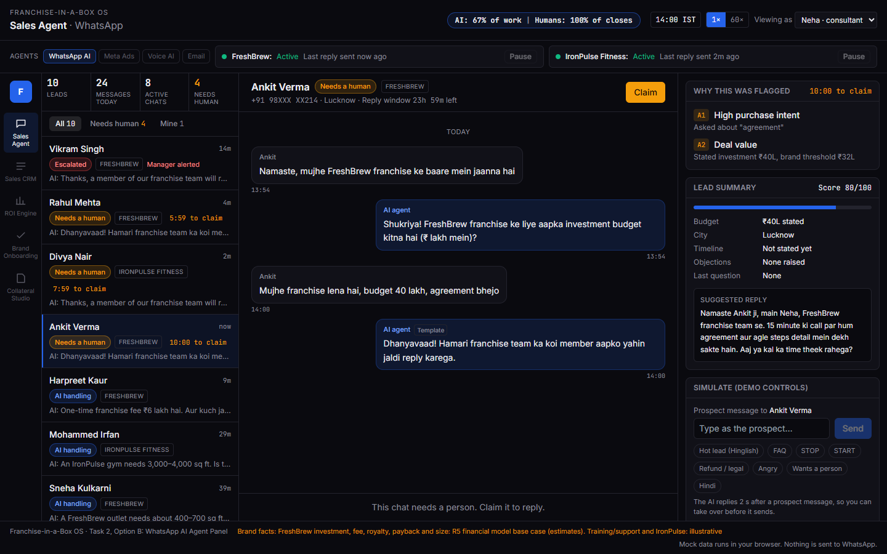
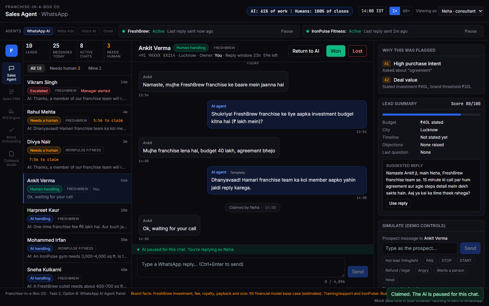
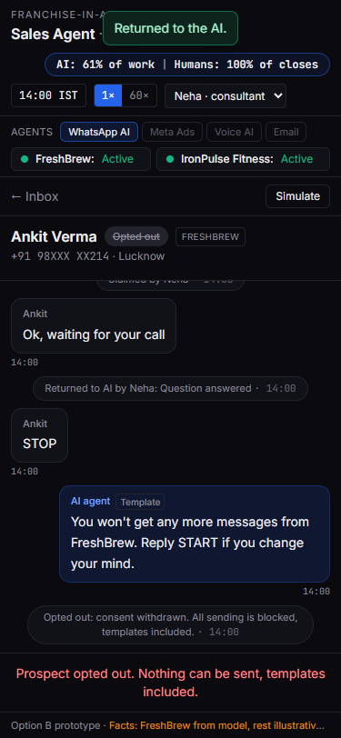

# Task 2, Option B: WhatsApp AI Agent Panel

**Live URL: https://fiab-r2b-whatsapp-agent-panel.vercel.app** (no login, works at 375 px)

A sales consultant's inbox for the WhatsApp AI agent. The AI answers prospects from approved facts. When a message needs a person (purchase intent, a big budget, a complaint, a legal or money question, a request for a human), the chat is flagged with the rule and the value that fired it. A consultant claims it, replies, and hands it back to the AI with a reason. The "AI share of work" badge is computed from the event log, so it moves as you work.

**Status: built, deployed and tested.** All 9 steps of the test script pass in a fresh browser at 1440 px and 375 px, both locally and on the live URL. FreshBrew's investment, fee, royalty, payback and outlet size now come from the [Task 5 financial model](../R5-financial-model/README.md) base case (T2B.18, redeployed and retested 17 Oct 2026).

## Try it in 60 seconds

1. Open the link and pick **Ankit Verma** in the inbox.
2. In **Simulate** (the right column; the "Simulate" button on a phone), click **Hot lead (Hinglish)**. The chat turns "Needs a human", "Why this was flagged" shows A1 + A2 with the values, and one holding message goes out.
3. Click **Claim**. The AI pauses; send another simulated message and the AI stays quiet.
4. Click **Return to AI**. It is blocked until you pick a reason.
5. Open **Rahul Mehta** (flagged), turn on **Second consultant** in Simulate, then click **Claim**: Priya gets it first, and you are told.

## Mocked vs real

| Real | Mocked |
|---|---|
| The state machine (7 states, guards, version check, repeat-click de-dup, cancel of a queued AI reply), the trigger rules (the same table as the R3 design), SLA and 24 h timers on a business-hours clock, and the autonomy badge computed from the event log | WhatsApp: nothing is sent. Prospect messages come from the Simulate box |
| 52 unit tests on the engine, and a Playwright run of the 9-step script through the real UI | The AI's replies are scripted from approved facts, not a model call (the live LLM is on the "1 more day" list) |
| | Data lives in the browser (no Supabase, no login). The "second consultant" is simulated in the same browser |
| | FreshBrew's ₹ figures come from the R5 model's base case, which is built from third-party listings and estimates, not a franchisor disclosure. Training/support and all IronPulse (fictional gym) facts are **illustrative**. Each fact-based reply is tagged "from R5 model" or "illustrative" on screen |

## Proof: the 9-step test

[`tests/e2e/nine-step.spec.ts`](../../prototypes/r2b-whatsapp-agent-panel/tests/e2e/nine-step.spec.ts) runs the script from [`tasks.md`](../../docs/requirements/R2B-whatsapp-agent-panel/tasks.md) in a fresh browser profile. **Result on 16 Oct 2026: 4 of 4 runs pass** (desktop 1440 px and phone 375 px, local build and live URL).

| Step | Checks | 1c criterion |
|---|---|---|
| 1 | Dark theme (`#0A0A0F` body) and a computed percentage in the badge | — |
| 2 | Hinglish hot lead → "Needs a human", A1 + A2 shown, exactly 1 holding message | AC1 |
| 3 | Claim → AI paused; a new prospect message gets 0 AI replies after 2.6 s | — |
| 4 | Return to AI is disabled without a reason; with one, the chat goes back to the AI | AC4 |
| 5 | STOP → opted out; no composer and no template button; page no wider than 375 px | AC7 |
| 6 | 4,097 characters → Send disabled, counter red; 4,096 sends | AC5 |
| 7 | Second consultant claims at the same moment → one "Claimed by" note, toast "Already claimed by Priya" | AC2 |
| 8 | Take over within the 2 s reply delay → "AI reply cancelled", 0 AI messages | AC9 |
| 9 | Double-click Take over → 1 assignment, 1 log entry | AC10 |

Run it: in `prototypes/r2b-whatsapp-agent-panel/`, `npm run e2e` (local), or `BASE_URL=https://fiab-r2b-whatsapp-agent-panel.vercel.app npm run e2e` (live).

## Screenshots

| Flagged, with reasons (desktop) | Claimed, AI paused (desktop) | Opted out (375 px) |
|---|---|---|
|  |  |  |

All taken by the Playwright run. More in [screenshots/](screenshots/).

## How it was built

Claude Code (Claude Opus 5.5) wrote the code; I gave the prompts, reviewed at checkpoints and made the scope calls. Stack: Vite, React, TypeScript, Tailwind, deployed on Vercel. Lovable was the original plan; I switched so the state machine could be unit-tested and the test script automated (decision D-01).

### Exact prompts, in order

Copied unedited from the [build log](build-log.md).

| # | Prompt | What came back |
|---|---|---|
| 1 | "let us now work on R2---At first we will work on R2B" | Read the requirement files; flagged that the R3 rules were still drafts; asked who should build |
| 2 | Choice: "Claude Code builds (Recommended)" + plan approved | The plan, then the scaffold and the engine with 45 unit tests |
| 3 | "Are all build log template/definition of done/ evaluation/features/phases and tasks for R2B run and output stored for each separately" | "No, only the build log." Proposed one status file per requirement doc |
| 4 | "yes do it" | The status files, and a test that the AI doesn't reply while a human has the chat |
| 5 | "are all steps built or just steps written - i want actual prototype now" | "Only the engine is built." Then the whole UI, with screenshots at desktop and 375 px |
| 6 | "Check if its correct-" + the full assignment brief, pasted | Found 3 gaps: all three options built though the brief says "Choose ONE"; Agent Switchboard and live tracking missing; the log didn't say who fixed what |
| 7 | "r2b" | Option B only. Added the Switchboard and live counts |
| 8 | "link of the build", then the five submission items pasted, then "Yes, use it (Recommended)" | "No live URL yet, only localhost." Rebuilt and scanned for keys |
| 9 | "it shld not affect previous project on versel" | Deployed as a brand-new Vercel project; existing projects untouched |
| 10 | "try now" | Deploy done; live URL checked with no login |
| 11 | "link to test" | The URL plus a manual test script |
| 12 | (a screenshot of an escalated chat, no text) | Found the suggested-reply bug (#14 below) |
| 13 | "fix and deploy" | Rewrote the suggested reply, 6 new tests, redeployed |
| 14 | "ok" (to starting the write-up and the 9-step test) | The Playwright test and this write-up |

### What the AI got wrong

15 entries in the [build log](build-log.md), each with component, symptom and cause. The ones worth knowing:

| # | Where | What went wrong | Why |
|---|---|---|---|
| 1 | Seed data | 22 of 45 tests failed on the first run: a Take over in the seed was refused (409) | The seed message "What is the process?" has no approved answer, so the engine correctly flagged it, and Take over only works on an AI-handled chat. The engine was right; the seed was wrong |
| 2 | Agent status (Error) | AC11 failed: no AI message was ever marked "failed" during an outage | Error was tied straight to the outage switch, so the next tick cancelled the queued reply before any send was tried. Nothing was logged as failed |
| 5 | Layout | Two elements with the same test id; the first was invisible | The flag cards were rendered twice (desktop column and phone drawer) and one hidden with CSS. It would also have broken the 9-step test |
| 6 | 375 px layout | Header, agent rows and footer took ~45% of the phone screen; the composer was pushed off the bottom | Sized for desktop; only sideways overflow had been checked |
| 9 | Scope | The plan built all three Task 2 options | Decision D-10 came from an older version of the brief, which nobody re-checked before building |
| 10 | Coverage | No Agent Switchboard and no live lead/message counts, though Module 4 names both | The build brief was written from the feature list, not the module description |
| 14 | Suggested reply | On an escalated chat it was signed by Neha (who couldn't send it), thanked the prospect for a question he never asked, and offered "agreement and next steps" when he'd asked for a call | One hard-coded sentence with the name swapped in, and no test |

Others: an ES2020 target that broke `Array.at` in the type-check (#4), a missing favicon 404 (#7), truncated stat labels (#11), a stale label pointing to the dropped Option C (#12), a deploy-connector 403 (#13), and the e2e test overwriting an existing screenshot (#15).

### What I fixed manually

Honest split: **Claude Code wrote every code fix.** My part was catching problems, making the calls and unblocking the deploy:

| I caught or decided | Fix that followed | Log # |
|---|---|---|
| Asked "Check if its correct" with the brief pasted, which surfaced the scope and coverage gaps | I chose Option B only; Claude Code removed A/C references and added the Switchboard and live counts | 9, 10 |
| Tested the live URL and sent a screenshot of the escalated chat | The suggested reply is now built from the chat: signed by whoever would send it, thanks only when a question was asked, answers the most urgent rule, gender-neutral Hindi; 6 tests | 14 |
| Asked "are all steps built or just steps written" when only the engine existed | The full UI was built and screenshotted | (prompt 5) |
| Approved the Vercel login in the browser when the connector returned 403 | Deployed with the CLI as a new project | 13 |

The test-caught bugs (#1–#8, #11, #12, #15) were found and fixed by Claude Code from its own test runs and screenshots.

### What I'd do with one more day

Each item closes a gap against a named acceptance criterion in the [1c takeover spec](../R1-product-thinking/1c-takeover-spec.md). Estimates are mine, about 8 h in total.

| # | Improvement | 1c criterion | Est. |
|---|---|---|---|
| 1 | Live LLM reply: Sonnet 5.5 with the R3 system prompt, scripted reply as fallback, key in a server function | AC1 (flag still in ≤ 2 s), AC9 (cancel must stop an in-flight call) | 3 h |
| 2 | Playwright for the timed criteria at 60× speed: escalation, 24 h template, no-reply re-flag, outage → Error | AC3, AC6, AC8, AC11 | 2 h |
| 3 | Tests that Claim and Return clear the SLA and no-reply clocks | AC3, AC8 | 1 h |
| 4 | "In SLA %" and "takeovers today" in the metrics strip | AC3 | 1 h |
| 5 | A Devanagari Hindi seed chat and a "बंद करो" opt-out screenshot | AC7 | 0.5 h |
| 6 | Tests for the lead summary's budget, timeline and score | AC1 | 0.5 h |

Beyond a day: a shared backend (Supabase with the version check in the database) so two real browsers can race a claim (AC2, AC10).

## Files in this folder

| File | Checks requirement file | What it contains |
|---|---|---|
| [build-brief.md](build-brief.md) | `tasks.md` T2B.01 | The approved build plan |
| [build-log.md](build-log.md) | `build-log-template.md` | Prompts verbatim, all 15 mistakes and fixes with "Caught by" and "Fixed by", the watch list, "1 more day". Filled in during the build |
| [features-status.md](features-status.md) | `features.md` | F2B.01–F2B.25 and W1–W6, with evidence |
| [tasks-status.md](tasks-status.md) | `tasks.md` | T2B.01–T2B.18 and the 9-step results |
| [phases-status.md](phases-status.md) | `phases.md` | Each phase against its exit criterion |
| [definition-of-done-check.md](definition-of-done-check.md) | `definition-of-done.md` | Every checklist item, ticked only with evidence |
| [evaluation-check.md](evaluation-check.md) | `evaluation.md` | Submission items, reviewer bars, decisions, risks |

**Code:** [`prototypes/r2b-whatsapp-agent-panel/`](../../prototypes/r2b-whatsapp-agent-panel/). `npm install`, then `npm run dev` (app), `npm run test` (52 unit tests) or `npm run e2e` (9-step test).
