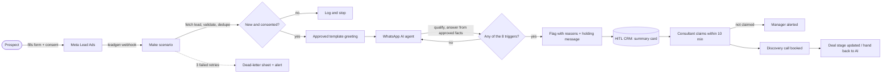

# Task 6A: Lead-flow automation (Meta Ads → WhatsApp → CRM → Consultant)

> **TL;DR.** A new Meta lead gets a WhatsApp reply within minutes, is qualified by the AI agent, and lands in the CRM with a 5-point summary. A consultant is pulled in only at the **8 Task 3 triggers** (buying intent, big budget, complaint, legal/money topic, request for a person, and so on). On Task 1's volumes this takes about **274 hours a month of manual lead handling off one brand's team, roughly 1.7 consultants**. All minute figures are estimates to calibrate in the pilot. The biggest risk is **WhatsApp templates and consent**: outside the 24-hour window only an approved template can be sent, and India's DPDP consent rules apply.
>
> **This is designed, not built.** I have not used Zapier or Make in production (A14). The same flow runs in prototype B with mock data: the trigger rules, takeover and hand-back are real code there; Meta, WhatsApp and the CRM are simulated. A [practice lab](../../practice/lead-flow-automation/README.md) also runs this flow end to end against fake Meta, WhatsApp and HubSpot APIs (plain Node and 3 n8n workflows, 23 passing tests); it has not been connected to real accounts.

## 1. Tools

| Hop | Tool | Why | Alternative |
|---|---|---|---|
| Lead capture | **Meta Lead Ads** (instant form with a consent checkbox) | Where the brief's leads start. Meta sends a `leadgen` webhook with a lead ID; a second Graph API call fetches the answers ([Meta webhooks guide](https://developers.facebook.com/documentation/ads-commerce/marketing-api/guides/lead-ads/quickstart/webhooks-integration)) | Landing page + form |
| Glue | **Make** (instant "New Lead" trigger from Facebook Lead Ads, then WhatsApp Business Cloud and HTTP modules; [Make integration page](https://www.make.com/en/integrations/facebook-lead-ads/whatsapp-business-cloud)) | No-code, visual, cheap at this volume, so a non-engineer on the brand team can read it | Zapier (same pattern); n8n if self-hosting matters; in production, the platform's own edge function (`docs/architecture.md` §3) |
| WhatsApp | **WhatsApp Business Platform** (Cloud API), directly or via an Indian BSP such as Interakt, WATI or Gupshup | A BSP adds an inbox, template management and INR billing support | Direct Cloud API only |
| AI agent | The **WhatsApp AI agent** from Task 3 (system prompt, approved facts, 8 triggers) | Answers from approved facts only; flags a person when needed | — |
| CRM | The platform's **HITL CRM** (module 5) (A29) | One timeline per lead; the takeover screen from Task 1c | **Google Sheets** as an interim sink until module 5 exists |
| Consultant alert + booking | In-app alert, plus WhatsApp/email to the consultant; **Google Calendar booking link** for the discovery call | The consultant acts within the 10-business-minute claim deadline (A22) | Slack alert |

## 2. Workflow steps

| # | Trigger | Action | Data passed | Owner | Latency target |
|---|---|---|---|---|---|
| 1 | Prospect submits the Meta instant form | Meta fires the `leadgen` webhook | `leadgen_id`, form ID, ad ID | Meta | Seconds |
| 2 | Webhook received | Fetch the lead; validate the phone (E.164); **dedupe by phone + brand**; store consent | Data contract below | Make (AI side) | < 1 min |
| 3 | Lead valid and consented | Send the approved **template** greeting (a new lead hasn't messaged yet, so only a template can open the chat) | Name, brand | Make → WhatsApp | ≤ 5 min (Task 1a target) |
| 4 | Prospect replies | The 24-hour window opens. The AI agent qualifies (budget, city, timeline) and answers from approved facts | Message, extracted fields | AI agent | Reply in under a minute |
| 5 | Every prospect message | Check the 8 triggers (§3). No trigger: the AI continues. Trigger: one flag with every reason | Reasons with the actual value | Rules engine | Instant |
| 6 | Flag raised | Holding message to the prospect; CRM card with the 5-point summary; alert the consultants on that brand | Summary, reasons, chat link | AI → CRM | Instant |
| 7 | Consultant claims | AI goes quiet; consultant replies and books the discovery call | Booking link | **Human** | Claim within 10 business min, else the manager is alerted (A22) |
| 8 | Call booked / deal moves | Deal stage updated; hand back to the AI with a reason if nothing more is needed | Stage, reason | **Human** (AI suggests the stage) | Same day |
| 9 | No reply in 24 h | One approved follow-up template; then stop | — | AI | Day 1, then day 3 |
| — | Any step fails | Retry 3 times with backoff; then write to a "dead letter" sheet and alert the ops owner | Error, payload | Make | Alert within 15 min |

**Data contract** (one row per lead): `lead_id, brand_id, name, phone (E.164), city, investment_range, source_ad_id, form_id, consent_ts, consent_text_version, created_at, status, assigned_to`.

## 3. Human checkpoints

These are the Task 3 triggers, word for word in intent ([Task 3, Part A](../R3-ai-agent-design/task3-ai-agent-design.md)). They are also the rules that run in prototype B.

| Checkpoint | When a person takes over |
|---|---|
| A1 High purchase intent | Prospect names a next step: agreement, payment, site visit, meeting |
| A2 Deal value | Stated investment ≥ the brand's full investment (₹32L for FreshBrew, from the Task 5 model), or 2+ outlets |
| A3 Low AI confidence | A question no approved fact answers |
| A4 Negative sentiment | Complaint or abuse |
| A5 Repeated question | Prospect says they weren't answered, or asks the same thing a third time |
| A6 Asked for a person | "Call me", "talk to someone" |
| A7 Legal / financial | Refund, guarantee, loan, GST, legal terms. The AI stays blocked until a person resolves it |
| A8 Out of scope | Job seekers, vendors, customers of the brand → routed to the right team |
| Plus | Every discovery call and every contract is human (Task 1b) |

## 4. Time saved

Built from Task 1's action table ([ai-human-split.csv](../R1-product-thinking/ai-human-split.csv)): volumes from A19 (500 leads a month per brand), minutes per action from A20. **Both are estimates, not measurements.**

| Lead-flow action (Task 1 row) | Times a month | Manual minutes each | Manual minutes a month |
|---|---|---|---|
| Capture lead + consent, validate, dedupe (22) | 500 | 3 | 1,500 |
| First WhatsApp reply (23) | 500 | 3 | 1,500 |
| Qualify on WhatsApp (24) | 500 | 15 | 7,500 |
| Answer FAQs from approved facts (25) | 1,000 | 2 | 2,000 |
| Follow-up nudges (28) | 1,000 | 1 | 1,000 |
| Spot when a person is needed (29) | 500 | 2 | 1,000 |
| Log the conversation in the CRM (31) | 500 | 3 | 1,500 |
| Summarise the lead for the consultant (32) | 60 | 10 | 600 |
| **Total** | | | **16,600 min ≈ 277 h** |

**Formula:** time saved per brand per month = Σ (frequency × manual minutes) for the automated steps − added human review.

- Added review (estimate): a consultant reads 10% of AI chats for 3 minutes each = 500 × 10% × 3 = 150 min.
- **Saved ≈ 16,600 − 150 = 16,450 min ≈ 274 hours a month per brand**, about **1.7 consultants** at 160 productive hours each (A35).
- Not counted as saved: the 60 takeovers a month (20 minutes each) and the discovery calls stay human either way.
- How to make it real: time 5 days of manual handling before the pilot (the Task 1b baseline), then compare consultant hours per lead after go-live.

## 5. The main risk: templates and consent

**What can go wrong.** Outside the 24-hour customer-service window, "template messages are the only message type that can be sent" ([Meta pricing docs](https://developers.facebook.com/docs/whatsapp/pricing), accessed 17 Oct 2026). If the greeting or follow-up template is rejected, paused for spam reports, or reclassified as Marketing (paid at a higher rate; Meta lists a higher India marketing rate from 1 Jan 2026), new leads get no reply. Separately, India's DPDP Rules were notified on 14 Nov 2025; most obligations, including notice and verifiable consent, apply 18 months later, around **May 2027** ([Deccan Herald](https://www.deccanherald.com/amp/story/india%2Fcentre-notifies-dpdp-rules-implementation-planned-in-phases-spread-over-12-18-months-3798465), [Hogan Lovells](https://www.hoganlovells.com/en/publications/indias-digital-personal-data-protection-act-2023-brought-into-force-)). A flow built without consent records would need rework before then.

**Mitigation.**
1. Get the greeting and follow-up templates approved **before** ads go live, as Utility where honest (a reply to the prospect's own enquiry), with a Marketing fallback version.
2. Put a clear consent line and checkbox on the Meta form; store `consent_ts` and `consent_text_version` with every lead; honour STOP at once (already in prototype B).
3. Watch template status daily; if a template is paused, the flow switches to the fallback and alerts the ops owner.

Secondary risks: duplicate leads (dedupe by phone + brand), Meta webhook outages (a scheduled "Watch Leads" poll as a backstop), Make operation limits (monthly cap alert).

## 6. Flow diagram

The full lead-to-close sequence, including the takeover states, is in [docs/architecture.md](../../docs/architecture.md) §3–4.

## Sources (all accessed 17 Oct 2026)

- Meta, [Pricing on the WhatsApp Business Platform](https://developers.facebook.com/docs/whatsapp/pricing): per-message pricing since 1 Jul 2025; templates only outside the service window; non-template messages and in-window utility templates free; higher India marketing rate from 1 Jan 2026.
- Meta, [Webhooks for Lead Ads](https://developers.facebook.com/documentation/ads-commerce/marketing-api/guides/lead-ads/quickstart/webhooks-integration): `leadgen` webhook and subscription steps.
- Make, [Facebook Lead Ads + WhatsApp Business Cloud integration](https://www.make.com/en/integrations/facebook-lead-ads/whatsapp-business-cloud).
- Deccan Herald, [Centre notifies DPDP Rules](https://www.deccanherald.com/amp/story/india%2Fcentre-notifies-dpdp-rules-implementation-planned-in-phases-spread-over-12-18-months-3798465) (Nov 2025); Hogan Lovells, [India's DPDP Act brought into force](https://www.hoganlovells.com/en/publications/indias-digital-personal-data-protection-act-2023-brought-into-force-). Exact phase dates should be checked against the Gazette before relying on them.
- WhatsApp 24-hour window and error 131047: verified 15 Oct 2026 (A23; sources in [Task 1c](../R1-product-thinking/1c-takeover-spec.md)).
