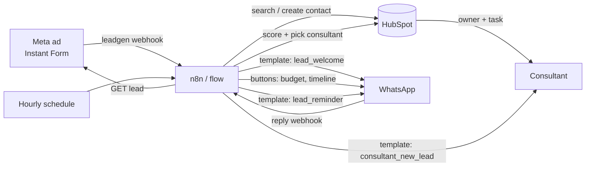

# Practice lab: Meta Ads → WhatsApp → CRM → Consultant

A hands-on sandbox for practising the lead flow from Module 4: a Facebook/Instagram lead is greeted on WhatsApp, qualified, stored in HubSpot and handed to the right consultant.

**You need no accounts, no keys and no spend.** A fake Meta + WhatsApp + HubSpot server runs on your laptop. It uses the real request and webhook shapes, and it enforces the rules that most often break real builds. When you're comfortable, the same flow points at real test accounts (Level 4).

| | What you get |
|---|---|
| `mocks/server.mjs` | Fake Meta Graph API, WhatsApp Cloud API and HubSpot CRM in one process, plus `/_test/*` buttons that play the prospect |
| `src/` | The reference flow in plain Node (no dependencies). Read it as the "answer key" |
| `n8n/` | The same flow as 3 importable n8n workflows. Tested on n8n 1.123.85 against the fakes |
| `tests/` | 23 tests. Each practice exercise has one |
| `scripts/demo.mjs` | One lead from start to finish, narrated |

Figures (₹25L minimum, FreshBrew, consultant names) are **illustrative practice values**, the same placeholders as prototype B.

---

## 1. The flow



| # | Step | Data in → out | Checkpoint (what stops or diverts it) |
|---|---|---|---|
| 1 | Meta sends a `leadgen` webhook | `leadgen_id` only, never the answers | Signature `X-Hub-Signature-256` must match the app secret |
| 2 | Already seen this `leadgen_id`? | HubSpot search on `fib_meta_lead_id` | Yes → stop. Meta retries webhooks, so duplicates are normal |
| 3 | Fetch the lead from the Graph API | `field_data` → name, phone, email, city, consent | Phone normalised to `91XXXXXXXXXX`; invalid → no WhatsApp |
| 4 | Find or create the HubSpot contact | Search by phone, then email | Existing contact → update, don't duplicate. Already with a consultant → just add a note |
| 5 | Consent? | `whatsapp_consent` form answer | No consent or no phone → **no WhatsApp**, a consultant gets a call task |
| 6 | Send `lead_welcome` **template** | Name, brand; buttons "Yes, tell me more" / "Not now" | Business-initiated, so it must be an approved template |
| 7 | Prospect replies → ask budget, city (if missing), timeline | Reply buttons; state saved on the contact as `fib_qual_step` | STOP → opt out at once. "Call me" → hand off at once. Two unclear answers → hand off |
| 8 | Score | hot / warm / cold / unqualified | Under ₹25L → unqualified, polite close, **not** assigned |
| 9 | Pick the consultant | City match → fewest open leads; skip unavailable or full | Nobody free → `handoff_queue` note |
| 10 | Hand off | HubSpot owner, lead status `OPEN`, lifecycle `salesqualifiedlead`, task due in 15 min (hot) / 2 h / 24 h; WhatsApp alert to consultant; thank-you to prospect | Thank-you only if the prospect's 24 h window is open |
| 11 | Hourly follow-up | Stalled leads | 4 h with no reply → `lead_reminder` template, max 2; then status `ATTEMPTED_TO_CONTACT` and hand off |

**Why state lives in HubSpot:** the flow keeps no memory of its own. Every webhook looks up the contact, reads `fib_qual_step`, acts, and writes the new step back. A restart, a retry or a second n8n worker never loses a lead, and the consultant sees exactly where each prospect is.

---

## 2. Quick start (2 minutes)

Needs Node 20+. No `npm install`.

```bash
cd practice/lead-flow-automation
npm run demo     # one lead, start to finish, narrated
npm test         # 23 tests, one per exercise
```

To poke at it by hand, use two terminals:

```bash
npm run mocks    # terminal 1: fake APIs on :4010
npm run flow     # terminal 2: the flow on :3010
```

Then play the prospect:

```bash
# A lead fills the ad form
curl -s -X POST localhost:4010/_test/lead -H 'Content-Type: application/json' -d '{
  "fields": {"full_name":"Rahul Sharma","email":"rahul@example.com","phone_number":"+91 98765 43210","city":"Pune","whatsapp_consent":"Yes"}}'

# Rahul taps "Yes, tell me more" on the welcome template
curl -s -X POST localhost:4010/_test/whatsapp -H 'Content-Type: application/json' -d '{"from":"919876543210","template_button":"welcome_yes"}'

# He taps the budget and timeline buttons
curl -s -X POST localhost:4010/_test/whatsapp -H 'Content-Type: application/json' -d '{"from":"919876543210","button_id":"budget_40p"}'
curl -s -X POST localhost:4010/_test/whatsapp -H 'Content-Type: application/json' -d '{"from":"919876543210","button_id":"time_0_3"}'

# Look at everything: contacts, tasks, notes, every WhatsApp message sent, every API call
curl -s localhost:4010/_inspect
```

Other test buttons: `{"from":"...","text":"STOP"}`, `{"text":"call me"}`, `{"deliver_twice":true}` (simulates Meta's retry), `{"referral":"<ad id>"}` (a Click-to-WhatsApp ad), `POST /_test/faults {"hubspot429":2}` (rate limits), `POST /_test/clock {"now":"2026-10-15T10:00:00Z"}` (time travel), `POST /_reset`.

---

## 3. Practice ladder

### Level 1 · Read and run (30 min)

1. Run `npm run demo`. For each line of output, find the function in `src/flow.mjs` that produced it.
2. Open `GET localhost:4010/_inspect` after the demo. Answer: how many API calls did one lead cost? Which ones could you remove?
3. Read `src/rules.mjs`. It holds every business rule as a small pure function: scoring, assignment, phone format, opt-out words, the 24 h window.

### Level 2 · Change it (each has a test to prove it)

| # | Exercise | Expected result | Test |
|---|---|---|---|
| E1 | Explain why the demo task is due at 05:15 | Hot leads get a 15-minute task (`TASK_DUE_MIN`) | Ex1 |
| E2 | Send the same lead with `"deliver_twice": true` | One contact, one welcome message | Ex2 |
| E3 | Submit a lead with `"whatsapp_consent":"No"` | No WhatsApp; a consultant gets a call task | Ex3 |
| E4 | Send STOP, then "hello", then START | Confirmation only; "hello" ignored; START resumes | Ex4 |
| E5 | Pick "Under ₹25L" | `UNQUALIFIED`, no owner, no task | Ex5 |
| E6 | Set `hubspot429: 2`, then send a lead | Retries succeed, lead not lost | Ex6 |
| E7 | Leave a lead unanswered and move the clock forward | 2 reminders 4 h apart, then hand off | Ex7 |
| E8 | Send a free-text WhatsApp to a number that never wrote to you | WhatsApp rejects it with **131047**; only templates work | Ex8 |
| E9 | Add **Hyderabad** to Arjun in `config.mjs` and write a test for it | Hyderabad leads go to Arjun | write it |
| E10 | Make ₹25–40L + 0–3 months **warm**, not hot. Which test breaks first? | Update `scoreLead` and the test | Ex1 |
| E11 | Mark Neha `available: false` and run the demo | Pune lead goes to the least-loaded consultant | rules test |
| E12 | Set `hubspot429: 5` (more than the 3 retries). What happens to the lead? | The webhook returns 500 and Meta retries it later; the duplicate check makes the retry safe. Then write down what you'd add for production (a queue, an alert) | discuss |
| E13 (stretch) | SLA escalation: if a hot lead's task isn't done in 15 min, WhatsApp the manager | New job like `runFollowUps` | write it |
| E14 (stretch) | Add a 4th question, "Do you have a shop space?" (Yes / Looking / No) | Remember: max 3 reply buttons, 20 characters each; the fake enforces it | write it |

### Level 3 · Build it in n8n against the fakes

1. Start n8n: `npx n8n` (or Docker: `docker run -it --rm -p 5678:5678 docker.n8n.io/n8nio/n8n`). Open <http://localhost:5678>.
2. **Import** `n8n/1-lead-intake.json`, `2-whatsapp-replies.json`, `3-follow-ups.json` (Workflows → Import from File).
3. In each workflow's **Config** node, check the URLs. With Docker, replace `localhost` with `host.docker.internal`.
4. **Activate** workflows 1 and 2.
5. Start the fakes pointing at n8n: `FLOW_URL=http://localhost:5678/webhook npm run mocks`
6. Run the curl commands from section 2. Watch each run under **Executions** in n8n.

n8n replies "Workflow was started" at once and works in the background. That is the production pattern: Meta retries slow webhooks, so acknowledge first, then process.

**n8n exercises.** Each workflow has a sticky note naming its gaps. The Node version in `src/` shows one way to solve each.

| # | Exercise | Hint |
|---|---|---|
| N1 | Verify `X-Hub-Signature-256` | Webhook node → Options → Raw Body. Code node needs `NODE_FUNCTION_ALLOW_BUILTIN=crypto`. See `verifySignature` |
| N2 | No consent → assign a consultant for a call | Reuse the owners → open leads → pick → task chain from workflow 2 |
| N3 | Re-ask once, then hand off | Keep a counter on the contact (`fib_reask_count`) |
| N4 | Unknown sender (Click-to-WhatsApp ad) | Create the contact; `message.referral.source_id` is the ad |
| N5 | After 2 reminders, really hand off | Today it only marks `ATTEMPTED_TO_CONTACT` |
| N6 | Replace the Config node's tokens with n8n **Credentials** | HTTP Request → Authentication → Generic → Bearer |
| N7 | Swap the HTTP nodes for n8n's built-in **Facebook Lead Ads Trigger**, **WhatsApp Trigger / WhatsApp Business Cloud** and **HubSpot** nodes | Do this in Level 4; the built-ins need real credentials |

**Known quirk (tested on n8n 1.123.85):** inside HTTP Request parameters, `$('Config').first().json.x` came back empty, while `$node["Config"].json.x` worked. The workflows use `$node[...]` in parameters and `$('...')` only inside Code nodes, where it works.

### Level 4 · Go live with free test accounts

Do this only with your own test numbers. Do not message real prospects until consent wording, templates and the opt-out are reviewed.

1. **Meta app + Lead Ads.** Create an app at developers.facebook.com, add Webhooks, subscribe your Page to the `leadgen` field. Permissions: `leads_retrieval`, `pages_manage_metadata`, `pages_show_list`, `pages_read_engagement`. Create an Instant Form with a **WhatsApp consent question** (custom question, unticked by default) and field names matching `parseLead` (`full_name`, `email`, `phone_number`, `city`, `whatsapp_consent`). Use Meta's **Lead Ads Testing Tool** to submit test leads without running an ad.
2. **WhatsApp Cloud API.** In the same app add WhatsApp. Meta gives a test business number and lets you add a few verified recipient numbers (your own phone). Create the three templates in WhatsApp Manager: `lead_welcome` (2 quick-reply buttons with payloads `welcome_yes` / `welcome_no`), `lead_reminder`, `consultant_new_lead`. Subscribe the webhook to `messages`.
3. **HubSpot.** A free account works. Create a private app with scopes `crm.objects.contacts.read/write`, `crm.objects.owners.read`, plus notes and tasks write access. Create the custom contact properties listed in `src/clients.mjs` (`fib_*`). Add your consultants as users so they appear as owners.
4. **A public URL for webhooks.** Meta must reach your n8n: use n8n Cloud, a small VPS, or a tunnel (`cloudflared` / `ngrok`) for testing. Register `https://<host>/webhook/webhooks/meta` and `.../webhooks/whatsapp` with your `VERIFY_TOKEN`.
5. Point the **Config** node (or `.env` for the Node version) at `https://graph.facebook.com/v21.0` (or the current version) and `https://api.hubapi.com`.

**Costs** depend on your plans and change often, so check current pricing before you start. n8n self-hosted Community Edition is free; n8n Cloud is paid. HubSpot's free CRM covers contacts, owners, tasks and notes. WhatsApp charges per template message by category and country; replies inside the 24 h window are cheaper or free. Meta ad spend is separate.

---

## 4. Rules that bite

1. **24-hour window.** You may send free-form messages only within 24 h of the prospect's last message. Outside it, only approved templates (error 131047). The first message after a form is always a template.
2. **Consent.** WhatsApp requires an opt-in before you message someone. Put a clear consent question on the form, store it (`fib_whatsapp_consent`), and honour STOP at once. For India, also check DPDP Act obligations with whoever owns compliance; this lab is not legal advice.
3. **Idempotency.** Meta and WhatsApp deliver webhooks at least once. Dedupe on `leadgen_id` and on the WhatsApp message id.
4. **Verify signatures.** Anyone can POST to a public webhook URL. Check `X-Hub-Signature-256` with your app secret.
5. **Acknowledge fast.** Reply 200 quickly and do the work afterwards, or Meta retries and disables a slow endpoint.
6. **Rate limits.** HubSpot returns 429. Retry with backoff (`Retry-After`); in n8n, turn on *Retry On Fail* (set on every HTTP node here).
7. **Buttons.** Max 3 reply buttons, 20 characters per title. Use a list message for more options.
8. **Never loop.** One re-ask, then a person. A bot that repeats itself loses the lead.

---

## 5. Measure it (what a PM would put on the dashboard)

| Metric | Definition | Where it comes from |
|---|---|---|
| Speed to lead | Lead created → first WhatsApp sent | `createdate` vs first outbound in the message log |
| Reply rate | Welcomed leads that replied at least once | `fib_last_inbound_at` set |
| Auto-qualification rate | Leads that reached a score without a person | `fib_lead_score` ≠ `unscored` |
| Time to consultant | Hand-off → task completed | HubSpot task timestamps |
| Opt-out rate | STOPs ÷ welcomed | `fib_wa_opt_out` |
| Hot-lead SLA | Hot tasks done within 15 min | Task due vs completed |

---

## 6. Files

```
practice/lead-flow-automation/
├── README.md              this guide
├── package.json           npm scripts only, no dependencies
├── src/config.mjs         brand, templates, buttons, consultants, timings: edit here
├── src/rules.mjs          pure business rules (score, assign, phone, consent, 24 h window)
├── src/clients.mjs        Meta / WhatsApp / HubSpot calls with retry
├── src/flow.mjs           the orchestration (intake, qualification, hand-off, follow-ups)
├── src/server.mjs         webhook endpoints for the Node version
├── mocks/server.mjs       the fake APIs and /_test buttons
├── n8n/*.json             the 3 n8n workflows
├── scripts/demo.mjs       narrated run
└── tests/                 unit + end-to-end tests
```
